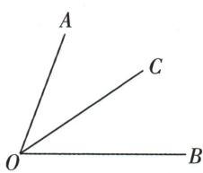
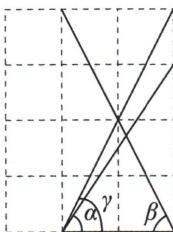

> [!success]- 必刷题
>
> > [!success] **【答案】** D
>
> > [!note]- **【解析】**
> > 如图, 因为 C 点是 $\angle AOB$ 内部任意一点, 并作射线 OC, 所以 $\angle AOC$ 与 $\angle BOC$ 的大小无法确定, $\angle AOB > \angle AOC$ , 故选 D.
> >
> > 
> >
> > 
> > (第1题图)
> > (第3题图)
