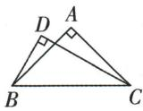
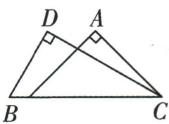
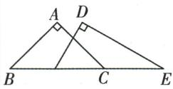

> [!success]- 必刷题
>
> > [!success] **【答案】** B
>
> > [!note]- **【解析】**
> > <table><tr><td>序号</td><td>分析</td><td>图示</td><td>结论</td></tr><tr><td>1</td><td> $\angle {ABD} = {60}^{ \circ } - {45}^{ \circ } = {15}^{ \circ },\angle {ACD} = {45}^{ \circ } - {30}^{ \circ } = {15}^{ \circ }$ </td><td></td><td>不符合题意</td></tr><tr><td>2</td><td> $\angle {ACD} = {45}^{ \circ } - {30}^{ \circ } = {15}^{ \circ }$ </td><td></td><td>不符合题意</td></tr><tr><td>3</td><td>没有15°角</td><td></td><td>符合题意</td></tr></table>
