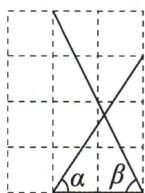
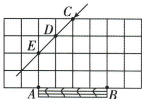

## 课时 1 角的比较与运算

建议用时 20 分钟 答案 D61

(第3题图)

(第4题图)

![[初中/课堂同步/教辅/必刷题/2026版《初中必刷题》数学 RJ  7上/06_第六章_几何图形初步/课时_1_角的比较与运算/questions/Q00099240.md]]
![[初中/课堂同步/教辅/必刷题/2026版《初中必刷题》数学 RJ  7上/06_第六章_几何图形初步/课时_1_角的比较与运算/questions/Q00099241.md]]
![[初中/课堂同步/教辅/必刷题/2026版《初中必刷题》数学 RJ  7上/06_第六章_几何图形初步/课时_1_角的比较与运算/questions/Q00099242.md]]

## 知识点 2 角的和差运算

![[初中/课堂同步/教辅/必刷题/2026版《初中必刷题》数学 RJ  7上/06_第六章_几何图形初步/课时_1_角的比较与运算/questions/Q00099243.md]]
![[初中/课堂同步/教辅/必刷题/2026版《初中必刷题》数学 RJ  7上/06_第六章_几何图形初步/课时_1_角的比较与运算/questions/Q00099244.md]]
![[初中/课堂同步/教辅/必刷题/2026版《初中必刷题》数学 RJ  7上/06_第六章_几何图形初步/课时_1_角的比较与运算/questions/Q00099245.md]]

## 易错点 对符合条件的角的位置情况考虑不周致错

![[初中/课堂同步/教辅/必刷题/2026版《初中必刷题》数学 RJ  7上/06_第六章_几何图形初步/课时_1_角的比较与运算/questions/Q00099246.md]]

# 课时2 角平分线

## 基础

## 知识点 1 角平分线

![[初中/课堂同步/教辅/必刷题/2026版《初中必刷题》数学 RJ  7上/06_第六章_几何图形初步/课时_1_角的比较与运算/questions/Q00099247.md]]
![[初中/课堂同步/教辅/必刷题/2026版《初中必刷题》数学 RJ  7上/06_第六章_几何图形初步/课时_1_角的比较与运算/questions/Q00099248.md]]
![[初中/课堂同步/教辅/必刷题/2026版《初中必刷题》数学 RJ  7上/06_第六章_几何图形初步/课时_1_角的比较与运算/questions/Q00099249.md]]
![[初中/课堂同步/教辅/必刷题/2026版《初中必刷题》数学 RJ  7上/06_第六章_几何图形初步/课时_1_角的比较与运算/questions/Q00099250.md]]
