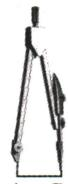
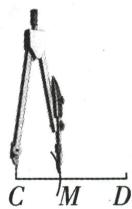

<!-- question-source:start -->
5[2025 贵州遵义期末]如图,已知线段 AB, CD, 小军同学进行如下操作:用圆规在线段 CD 上截取 CM=AB. 则下列结论一定成立的是 （）

A. $AB = CD$ B. $AB > CD$ C. $CM = MD$ D. $AB <   CD$
<!-- question-source:end -->

![[Q00100727A1]]
