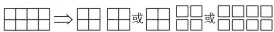

> [!success]- 必刷题
>
> > [!success] **【答案】** A
>
> > [!note]- **【解析】**
> > - **①**：三角形；
> > - **②**：长方形；
> > - **④**：圆，它们的各部分都在同一平面内，属于平面图形。
> > - **③**：正方体；
> > - **⑤**：四棱锥；
> > - **⑥**：圆柱，它们的各部分不都在同一平面内，属于立体图形。故选 A.
> >
> > 7.2 或 5 或 8 【解析】如图所示：
> >
> > 
> > 课时 2 从不同的方向看物体及立体图形的展开图
