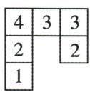
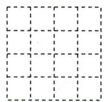
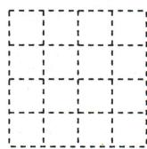

<!-- question-source:start -->
5[2025 山东淄博期末, 中]一个几何体由若干个棱长为 $1 \mathrm{~cm}$ 的小正方体搭成, 从上面观察这个几何体, 得到的形状图如图所示, 其中小正方形中的数字表示在该位置上小正方体的个数.

从上面看
从前面看

从左面看

(1)请分别在网格图中画出从前面、左面观察这个几何体得到的形状图；
(2)求该几何体的表面积.
<!-- question-source:end -->

![[Q00099181A1]]
