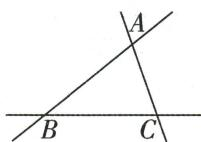
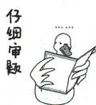

<!-- question-source:start -->
8 直线 AB, BC, CA 的位置关系如图所示, 则下列语句: ①点 B 在直线 BC 上; ②直线 AB 经过点 C; ③直线 AB, BC, CA 两两相交; ④点 B 是直线 AB, BC 的交点.
以上语句正确的有\_\_\_\_。(只填写序号)

<!-- question-source:end -->

![[Q00099199A1]]
