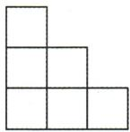
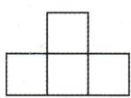

<!-- question-source:start -->
1[2024 安徽芜湖期中, 中]用若干个相同的小立方块搭成的几何体, 从前面和上面看到的形状图如图, 则组成这样的几何体需要小立方块的块数为 ( )

从前面看

从上面看

A. 最多需要 8 块,最少需要 6 块
B. 最多需要 9 块,最少需要 6 块
C. 最多需要 8 块,最少需要 7 块
D. 最多需要 9 块,最少需要 7 块
<!-- question-source:end -->

![[Q00099386A1]]
