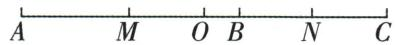

<!-- question-source:start -->
2[2025 安徽淮南期末, 中]如图, 点 B 在线段 AC 上(不与 A, C 重合), 点 M, N 分别为线段 AB, BC 的中点, 点 O 是线段 AC 的中点, 有下列结论: ① MN = CO; ② 2MO = AO - BO; ③ AM = BN; ④ 2NO = CO + BO. 其中正确的结论有 \_\_\_\_. (填序号)

<!-- question-source:end -->

![[Q00100740A1]]
