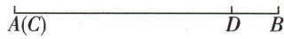
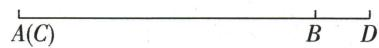

> [!success]- 必刷题
>
> > [!success] **【答案】** (1) > (2) = (3) <
>
> > [!note]- **【解析】**
> > (1) 如图(1)，当点 D 落在线段 AB 上时（不与点 B 重合），AB > CD.
> >
> > 
> > 图(1)
> >
> > (2)如图(2)，当点D与点B重合时，AB=CD. $A(C)$ $B(D)$
> >
> > (3)如图(3)，当点 $D$ 落在线段 $AB$ 的延长线上时， $AB < CD$ .
> >
> > 
> > 图(3)
