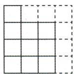
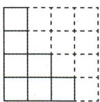

> [!success]- 必刷题
>
> > [!success] **【答案】** 详见解析
>
> > [!note]- **【解析】**
> > 【解】(1)如图所示.
> >
> > 
> > 从前面看
> >
> > 
> > 从左面看
> >
> > ## 归纳总结
> >
> > 由小正方形构成的能折叠成正方体的平面图形具有以下特点:(1)一线不过四;(2)“田”“凹”要弃之;(3)相连必相邻.
> >
> > (2) $(6+6+10+10+7+7)\times1\times1+4\times1\times1=50(\mathrm{~cm}^{2})$ 所以这个几何体的表面积为 $50 \, cm^{2}$ .
> >
> > ## 刷素养·
