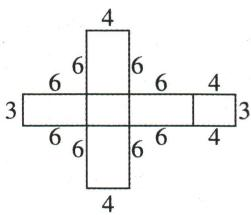

> [!success]- 必刷题
>
> > [!success] **【答案】** ①②
>
> > [!note]- **【解析】**
> > 【解】(1)可能是该长方体展开图的有①②.故答案为①②.
> > (2)题图(3)的外围周长为 $4 \times 6 + 4 \times 4 + 6 \times 3 = 58$ .
> >
> > (3)外围周长最大的展开图如图所示:
> >
> > 
> >
> > 易错警示
> > 以该长方形的一边所在直线为轴,即以长或宽所在直线为轴,共两种情况,注意不要漏解.
> >
> > 由图可知,此展开图的外围周长为 $8 \times 6 + 4 \times 4 + 3 \times 2 = 70$ .
