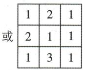
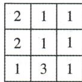

> [!success]- 必刷题
>
> > [!success] **【答案】** C
>
> > [!note]- **【解析】**
> > 由题图可知,这个几何体是圆柱.故选 C.
> >
> > 5.3 【解析】由从上面看得到的平面图形可知最底层小立方块的个数为9,由另外两个方向看得到的平面图形可知第三层有1个小立方块,那么第二层有3个小立方块,结合图形可知这个几何体的搭法共有3种,如图所示,数字表示该位置小立方块的个数.故答案为3.
> >
> > <table><tr><td>2</td><td>1</td><td>1</td></tr><tr><td>1</td><td>2</td><td>1</td></tr><tr><td>1</td><td>3</td><td>1</td></tr></table>
> >
> > 从上面看
> >
> > 
> >
> > 
> > 从上面看
> > 从上面看
