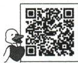

## 课时 2 从不同的方向看物体及立体图形的展开图 刷基础

## 6.1.1 立体图形与平面图形

  
电子错题本鸭

课时 1 认识几何图形

## 知识点 1 生活中的几何图形

![[初中/课堂同步/教辅/必刷题/2026版《初中必刷题》数学 RJ  7上/06_第六章_几何图形初步/课时_2_从不同的方向看物体及立体图形的展开图/questions/Q00097286.md]]
## 知识点 2 立体图形

![[初中/课堂同步/教辅/必刷题/2026版《初中必刷题》数学 RJ  7上/06_第六章_几何图形初步/课时_2_从不同的方向看物体及立体图形的展开图/questions/Q00097287.md]]
![[初中/课堂同步/教辅/必刷题/2026版《初中必刷题》数学 RJ  7上/06_第六章_几何图形初步/课时_2_从不同的方向看物体及立体图形的展开图/questions/Q00097288.md]]
![[初中/课堂同步/教辅/必刷题/2026版《初中必刷题》数学 RJ  7上/06_第六章_几何图形初步/课时_2_从不同的方向看物体及立体图形的展开图/questions/Q00097289.md]]
## 知识点 3 平面图形

![[初中/课堂同步/教辅/必刷题/2026版《初中必刷题》数学 RJ  7上/06_第六章_几何图形初步/课时_2_从不同的方向看物体及立体图形的展开图/questions/Q00097290.md]]
![[初中/课堂同步/教辅/必刷题/2026版《初中必刷题》数学 RJ  7上/06_第六章_几何图形初步/课时_2_从不同的方向看物体及立体图形的展开图/questions/Q00097291.md]]
![[初中/课堂同步/教辅/必刷题/2026版《初中必刷题》数学 RJ  7上/06_第六章_几何图形初步/课时_2_从不同的方向看物体及立体图形的展开图/questions/Q00097292.md]]
# 课时 2 从不同的方向看物体及立体图形的展开图

## 知识点 1 从不同的方向看立体图形
