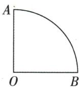
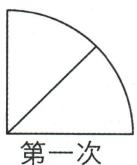
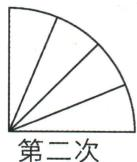
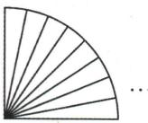

<!-- question-source:start -->
3[2024天津南开区期末,中]如图(1)是一个 $\frac{1}{4}$ 的圆( $\angle AOB=90^{\circ}$ ),如图(2),芳芳第一次在图(1)中画了一条线,将图(1)等分成2份,第二次又加了两条线,将图(1)等分成4份,第三次又加了四条线,将图(1)等分成8份,第四次又加了八条线,将图(1)等分成16份,则第 $n(n>1)$ 次可将图(1)等分成\_\_\_\_份,当 $n=5$ 时,图(1)被分成的每份的角度是\_\_\_\_(用度、分、秒表示).

图(1)

图(2)

第三次

刷素养▶ 走向重高
<!-- question-source:end -->

![[Q00097798A1]]
