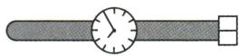
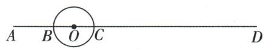
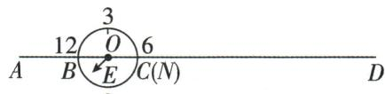
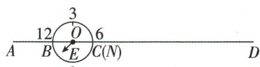

<!-- question-source:start -->
4 核心素养推理能力 [2024 河北保定期末,较难]爱钻研的琪琪发现,将图(1)所示的手表理解成图(2)所示的数学模型(点 A 和点 D 是表带的两端, 点 A, B, C, D 在同一条线段上), 可以产生下面的数学问题.

图(1)

图(2)

图(3)

图(4)

(1)已知表盘直径 BC 为 4 cm, CD = 4AB, 若 B 是 AC 中点, 则表带 CD = \_\_\_\_ cm.

(2)在某个时刻,分针 ON 指向表盘上的数字“6”(此时 ON 与 OC 重合).时针为 OE,表盘显示时间为 10:30,如图(3)所示.
①10:30 时分针和时针的夹角为 \_\_\_\_ 度;
②作射线 OF,使 $\angle EOF = 20^{\circ}$ ,求此时 $\angle BOF$ 的度数.

(3)如图(4)所示,自10:30之后,若射线OF 始终是∠EON的平分线(分针还是ON),在一小时以内,经过\_\_\_\_分钟后,∠EOF的度数是25°.

电子错题本鸭
<!-- question-source:end -->

![[Q00097799A1]]
