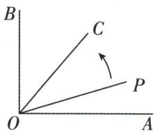

<!-- question-source:start -->
2 新考法 [2025 江苏无锡期末, 中] 如图, $\angle AOB$ 是直角, $\angle AOC = 50^{\circ}$ , 射线 $OP$ 从边 $OA$ 出发, 绕点 $O$ 逆时针旋转直至与边 $OB$ 重合, 在旋转过程中, 下列情形不可能出现的是 ( )

A. $OP$ 平分 $\angle AOC$ B. $OP$ 平分 $\angle AOB$ C. $OC$ 平分 $\angle BOP$ D. $OC$ 平分 $\angle AOP$
<!-- question-source:end -->

![[Q00099255A1]]
