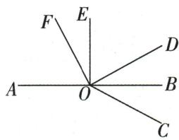

<!-- question-source:start -->
6 如图所示, 已知 O 是直线 AB 上一点, $\angle BOE = \angle FOD = 90^{\circ}$ , OB 平分 $\angle COD$ .

(1)图中与 $\angle DOE$ 互余的角有

(2)图中是否有与 $\angle DOE$ 互补的角？如果有，直接写出全部结果；如果没有，说明理由.

<!-- question-source:end -->

![[Q00099263A1]]
