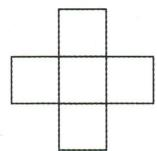

<!-- question-source:start -->
4[2024 陕西中考]小华探究“幻方”时,提出了一个问题:如图,将0,-2,-1,1,2这五个数分别填在五个小正方形内,使横向三个数之和与纵向三个数之和相等,则填入中间位置的小正方形内的数可以是\_\_\_\_.(写出一个符合题意的数即可)

不愧是我鸭
<!-- question-source:end -->

![[Q00100823A1]]
