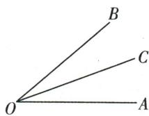

> [!success]- 必刷题
>
> > [!success] **【答案】** C
>
> > [!note]- **【解析】**
> > 如图, A 选项, $\angle AOC = \angle BOC$ 能确定 $OC$ 平分 $\angle AOB$ , 故此选项不符合题意; B 选项,
> >
> > 
> >
> > $\angle AOB=2\angle AOC$ 能确定 OC 平分 $\angle AOB$ ，故此选项不符合题意；C 选项， $\angle AOC+\angle COB=\angle AOB$ 不能确定 OC 平分 $\angle AOB$ ，故此选项符合题意；D 选项， $\angle BOC=\frac{1}{2}\angle AOB$ 能确定 OC 平分 $\angle AOB$ ，故此选项不符合题意。故选 C.
> >
> > 根据角平分线的定义可得 $\angle EOD = \frac{1}{2}\angle AOD,$ $\angle DOF = \frac{1}{2}\angle BOD$ ，结合平角的定义可求得 $\angle EOF = 90^{\circ}$ ，由 $\angle EOF$ 的度数为定值即可得出结论.
> >
> > ## 思路分析
