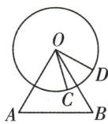
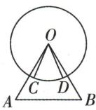
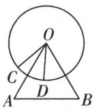

> [!success]- 必刷题
>
> > [!success] **【答案】** 详见解析
>
> > [!note]- **【解析】**
> > 【解】(1)由题意得 $\angle COD=\frac{360^{\circ}}{8}=45^{\circ}$ .
> >
> > (2)因为 $\angle AOB=60^{\circ}$ , $OC$ 平分 $\angle AOB$ , 所以 $\angle BOC=\frac{1}{2}$ $\angle AOB=30^{\circ}$ , 所以 $\angle BOD=\angle COD-\angle BOC=15^{\circ}$ .
> >
> > (3) $\angle AOC$ 的度数为 $x^{\circ}-15^{\circ}$ 或 $15^{\circ}-x^{\circ}$ 或 $x^{\circ}+15^{\circ}$ . 当 $OC$ 在 $\angle AOB$ 内, $OD$ 在 $\angle AOB$ 外时,如图(1)所示. 因为 $\angle BOD=x^{\circ}$ , $\angle COD=45^{\circ}$ ,所以 $\angle BOC=\angle COD-\angle BOD=45^{\circ}-x^{\circ}$ . 因为 $\angle AOB=60^{\circ}$ , 所以 $\angle AOC=\angle AOB-\angle BOC=15^{\circ}+x^{\circ}$ ;
> >
> > 
> > 图(1)
> >
> > 
> > 图(2)
> >
> > 当 OC, OD 都在 $\angle AOB$ 内时, 如图(2)所示. 因为 $\angle BOD = x^{\circ},\angle COD = 45^{\circ},\angle AOB = 60^{\circ}$ ，所以 $\angle AOC = \angle AOB - \angle BOD - \angle COD = 15^{\circ} - x^{\circ};$ 当 $OC$ 在 $\angle AOB$ 外， $OD$ 在 $\angle AOB$ 内时，如图(3)所示.因为 $\angle BOD = x^{\circ},\angle COD = 45^{\circ},$ $\angle AOB = 60^{\circ}$ ，所以 $\angle AOC = \angle BOD + \angle COD-$ $\angle AOB = x^{\circ} - 15^{\circ}.$
> >
> > 
> > 图(3)
> >
> > 综上所述, $\angle AOC$ 的度数为 $x^{\circ}-15^{\circ}$ 或 $15^{\circ}-x^{\circ}$ 或 $15^{\circ}+x^{\circ}$ .
