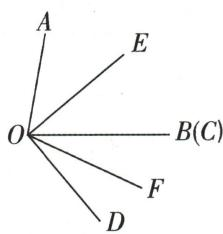
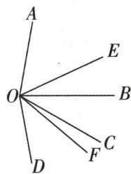

<!-- question-source:start -->
3[2024 四川南充期末, 中]已知 $\angle AOB = 80^{\circ}$ , $\angle COD = 50^{\circ}$ , $OE$ 平分 $\angle AOC$ , $OF$ 平分 $\angle BOD$ . (1) 如图(1), 当 $OB, OC$ 重合时, 求 $\angle EOF$ 的度数.

(2) 当 $\angle COD$ 绕点 O 顺时针旋转 $n^{\circ}(0 < n < 50)$ 时（如图(2)）， $\angle EOF$ 的度数是否为定值？若是定值，求出 $\angle EOF$ 的值；若不是，请说明理由.
(3) 在 (2) 的条件下，若满足 $\angle AOD - \angle EOF = \frac{3}{2} (\angle BOE + \angle COF)$ ，求 n 的值.

图(1)

图(2)
<!-- question-source:end -->

![[Q00100793A1]]
