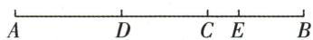
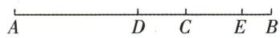
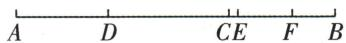
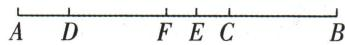

> [!success]- 必刷题
>
> > [!success] **【答案】** 详见解析
>
> > [!note]- **【解析】**
> > 【解】(1) 因为 AC = 2BC, AB = 15, 所以 AC = $\frac{2}{3} \times 15 = 10$ , $BC = \frac{1}{3} \times 15 = 5$ . 由题意, 分两种情况: ① 当点 E 靠近点 C 时, 如图(1)所示.
> >
> > 
> > 图(1)
> >
> > (1) 分点 E 靠近点 C 和点 E 靠近点 B 两种情况讨论.
> >
> > 因为点 E 为 BC 的三等分点, 所以 $CE = \frac{1}{3}CB = \frac{5}{3}$ , 所以 $DC = DE - CE = 6 - \frac{5}{3} = \frac{13}{3}$ , 所以 $AD = AC - DC = 10 - \frac{13}{3} = \frac{17}{3}$ .
> > - **②**：当点 E 靠近点 B 时, 如图(2)所示.
> >
> > 
> > 图(2)
> >
> > 因为点 E 为 BC 的三等分点, 所以 $CE = \frac{2}{3}CB = \frac{10}{3}$ , 所以 $DC = DE - CE = 6 - \frac{10}{3} = \frac{8}{3}$ , 所以 AD = AC - DC = $10 - \frac{8}{3} = \frac{22}{3}$ . 综上所述, 线段 AD 的长为 $\frac{17}{3}$ 或 $\frac{22}{3}$ .
> >
> > 归纳总结
> > 角的表示方法的优缺点:
> > - **①**：用三个大写英文字母来表示,适用于所有的角,但比较繁琐;
> > - **②**：用顶点处的一个大写英文字母来表示角时比较简便,但只适用于以这个点为顶点的角只有一个的情况;
> > - **③**：用数字或小写希腊字母来表示角比较简便,但需在图中标上相应的数字或小写希腊字母,另外当要表示的角较多且集中时,会比较乱.
> >
> > (2)依题意,分两种情况:
> > - **①**：如图(3)所示,当点 F 在点 C 右侧时,
> >
> > 
> > 图(3)
> >
> > 因为 AC=10, CF=3, 所以 $AF=AC+CF=10+3=13$ . 因为 AF=3AD, 所以 $AD=\frac{1}{3}AF=\frac{13}{3}$ . 因为 DE=6, 所以 $AE=AD+DE=\frac{13}{3}+6=\frac{31}{3}$ .
> > - **②**：如图(4)所示, 当点 F 在点 C 左侧时,
> >
> > 
> > 图(4)
> >
> > 因为 AC=10, CF=3, 所以 AF=AC-CF=10-3=7. 因为 AF=3AD, 所以 $AD=\frac{1}{3}AF=\frac{7}{3}$ , 所以 $AE=AD+DE=\frac{7}{3}+6=\frac{25}{3}$ .
> > 综上所述，AE 的长为 $\frac{31}{3}$ 或 $\frac{25}{3}$ .
