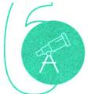

<!-- source-part:1 pages:1-50 -->

# 初中 必刷题 CHUZHONG BISHUATI 2026

主 编：杨文彬

编者：李厚明 张雄波 蔡宝霞 贾芳芳 韩成 孙继平 王许兵 杨金娣 程芳园 马士荣 张立界 王春荣 程铭 田丽华 王梅 宋春梅 张艳冬

订：邱邦有 李业法 桑静华 刘新民 车鸣丽
徐瑞 李芹 黄勇 汪玲 王艳秋
王志宽 王汝彦

电子错题本

开明出版社

数学
七年级上册 RJ

## CONTENTS 目录

## 第一章 有理数

1.1 正数和负数 …… 刷基础 提升 (1) (D1)
1.2 有理数及其大小比较 …… (3) (D2)
1.2.1 有理数的概念 …… 刷基础 (3) (D2)
1.2.2 数轴 …… 刷基础 提升 (4) (D3)
1.2.3 相反数 …… 刷基础 (6) (D4)
1.2.4 绝对值 …… 刷基础 提升 (7) (D4)
1.2.5 有理数的大小比较 …… 刷基础 (9) (D6)
数学活动 …… 刷活动 (10) (D6)
全章综合训练 …… 刷中考 章测 (11) (D7)

重难题型微课具有相反意义的量的表示 P2T3 数轴上的整点问题 P5T2

## 第二章 有理数的运算

2.1 有理数的加法与减法 …… (14) (D9)
2.1.1 有理数的加法 …… (14) (D9)
课时1 有理数的加法 …… 刷基础 提升 (14) (D9)
课时2 有理数的加法运算律 …… 刷提升 (16) (D10)
2.1.2 有理数的减法 …… (17) (D11)
课时1 有理数的减法 …… 刷基础 (17) (D11)
课时2 有理数的加减混合运算 …… 刷基础 提升 (18) (D11)
2.2 有理数的乘法与除法 …… (20) (D12)
2.2.1 有理数的乘法 …… (20) (D12)
课时1 有理数的乘法 …… 刷基础 (20) (D12)
课时2 有理数的乘法运算律 …… 刷基础 提升 (21) (D13)
2.2.2 有理数的除法 …… (23) (D14)
课时1 有理数的除法 …… 刷基础 (23) (D14)
课时2 有理数的加减乘除混合运算 …… 刷基础 提升 (24) (D15)
重难专题1 巧用运算规律简化有理数的计算 …… 刷难关 (26) (D16)
2.3 有理数的乘方 …… (28) (D17)
2.3.1 乘方 …… (28) (D17)
课时1 有理数的乘方 …… 刷基础 (28) (D17)

## 新考法 新素材

研究对比全国近十年中考真题卷,发现各省市的中考会不断借鉴或探究新考法,同时会挖掘时事热点等新素材,创造新情境灵活考查知识点。中考是我们平时学习的风向标,因此我们需要关注新考法、新素材。

## 新考法

\- 绝对值与数轴相结合 ▶P8/T2
- 有理数减法法则的应用 ▶P17/T1
- 分配律的应用 ▶P22/T4
- 阅读材料型题目 ▶P61/T5
- 新定义“滑行方程”的应用 ▶P87/T13
- 角的和差运算 ▶P99/T7
- 角平分线的应用 ▶P101/T2

## 新素材

\- 以神舟十九号载人飞船为背景考查具有相反意义的量
- P1/T5
- 以《哪吒之魔童闹海》为背景考查科学记数法
- P37/T2

## ▶ 新考向 ◀

## 推荐理由

教育部发布的《关于加强初中学业水平考试命题工作的意见》中指出：弘扬中华优秀传统文化，提高探究性、开放性试题比例，积极探索跨学科命题，提高试题情境设计水平。结合《义务教育数学课程标准（2022年版）》新变化，通过分析全国百余套中考试题，发现以传统文化为背景的试题，以及探究性、开放性、综合性、跨学科试题在中考中出现得越来越频繁，故精选部分试题，让学生感受考向变化。

## 目录

课时2 含乘方的有理数混合运算 … 刷基础 提升 (29) (D17)
2.3.2 科学记数法 …… 刷基础 (31) (D18)
2.3.3 近似数 …… 刷基础 (32) (D19)
大招专题1 有关数轴的探索 …… 刷难关 (33) (D19)
数学活动 …… 刷活动 (34) (D21)
综合与实践 进位制的认识与探究 …… 刷实践 (35) (D21)
全章综合训练 …… 刷中考 章测 (36) (D21)

## 重难题型微课

## 第三章 代数式

3.1 列代数式表示数量关系 …… (39) (D24)
课时 1 代数式 …… 刷基础 (39) (D24)
课时 2 列代数式 …… 刷基础 提升 (40) (D24)
课时 3 正比例和反比例关系 …… 刷基础 提升 (42) (D25)
3.2 代数式的值 …… (44) (D26)
课时 1 代数式的值 …… 刷基础 (44) (D26)
课时 2 求代数式的值的应用 …… 刷基础 提升 (45) (D27)
数学活动 …… 刷活动 (47) (D28)
全章综合训练 …… 刷中考 章测 (48) (D28)

## 第四章 整式的加减

4.1 整式 …… (51) (D30)
课时 1 单项式 …… 刷基础 (51) (D30)
课时 2 多项式及整式 …… 刷基础 提升 (52) (D31)
重难专题 2 规律探索 …… 刷难关 (54) (D32)
4.2 整式的加法与减法 …… (55) (D33)
课时 1 同类项与合并同类项 …… 刷基础 (55) (D33)
课时 2 去括号 …… 刷基础 (56) (D33)
课时 3 整式的加减 …… 刷基础 提升 (57) (D34)
重难专题 3 整式的化简求值 …… 刷难关 (59) (D35)
数学活动 …… 刷活动 (61) (D36)

## 专题索引

## 微专题

微专题1 绝对值最值问题 P8
微专题2 整式中不含（无关）问题 P58
微专题3 解含绝对值的一元一次方程 P70
微专题4 线段计算中的特殊思想 P95

## 重难专题

重难专题1 巧用运算规律简化有理数的计算 P26
类型1 归类——同号相加,同分母相加
类型2 凑整——将和(积)为整数的数相结合
类型3 变序——方便约分和计算
类型4 组合——找出规律,重新组合,然后通过约分或抵消简化计算
类型5 拆分——将带分数拆分
类型6 裂项——拆项相消
类型7 换位——将被除数与除数颠倒位置
重难专题2 规律探索 P54
类型1 递推型规律探索
类型2 累加型规律探索
重难专题3 整式的化简求值 P59
类型1 化繁为简再求值
类型2 整体代入求值
类型3 整式化简中的“无关”问题
类型4 利用数形结合化简求值
重难专题4 特殊一元一次方程的解法技巧 P73
类型1 分子、分母化整
类型2 利用倒数关系去括号
类型3 整体思想的应用
类型4 先拆分,再合并

## 目录

全章综合训练·

累加型规律探索 P54T4 整式化简中的“无关”问题 P60T7

## 第五章 一元一次方程

5.1 方程 …… (64) (D38)
5.1.1 从算式到方程 …… 刷基础 (64) (D38)
5.1.2 等式的性质 …… 刷基础 提升 (65) (D38)
5.2 解一元一次方程 …… (67) (D39)
课时1 解一元一次方程 —— 合并同类项
…… 刷基础 (67) (D39)
课时2 解一元一次方程 —— 移项
…… 刷基础 (68) (D40)
课时3 解一元一次方程 —— 去括号
…… 刷基础 提升 (69) (D41)
课时4 解一元一次方程 —— 去分母
…… 刷基础 提升 (71) (D42)
重难专题4 特殊一元一次方程的解法技巧 … 刷难关 (73) (D44)
大招专题2 含参数的一元一次方程 …… 刷难关 (74) (D44)
5.3 实际问题与一元一次方程 …… (75) (D45)
课时1 产品配套问题与工程问题
…… 刷基础 提升 (75) (D45)
课时2 销售盈亏问题…… 刷基础 提升 (77) (D46)
课时3 积分问题与行程问题…… 刷基础 提升 (79) (D47)
课时4 分段计费问题与方案问题
…… 刷基础 提升 (81) (D49)
大招专题3 方程的应用——动点问题 …… 刷难关 (83) (D50)
数学活动 …… 刷活动 (84) (D51)
全章综合训练…… 刷中考 章测 (85) (D52)

## 重难题型微课

方程的恒解问题 P72T3 利用整体思想解方程 P73T6
工程问题 P76T1 行程问题 P80T2
方案问题 P82T2

## 专题索引

重难专题5 线段中的动态问题 P97
类型1 动点问题
类型2 动线段问题
类型3 定值问题

## 重难专题6 动角问题 P104

类型1 判断角的数量关系
类型2 求运动时间
类型3 定值问题

## 大招专题

大招专题1 有关数轴的探索 P33
母题学大招1 数轴中的折叠问题
母题学大招2 数轴上的循环规律问题
母题学大招3 数轴上数的变化规律问题

## 大招专题2 含参数的一元一次方程

母题学大招4 解的关系问题
母题学大招5 错解问题
母题学大招6 整数解问题
母题学大招7 解的个数问题

## 大招专题3 方程的应用——动点问题 P83

母题学大招8 距离问题
母题学大招9 相遇问题
母题学大招10 追及问题

大招专题4 与线段上的中点有关的计算 P96母题学大招11 双中点模型母题学大招12 三中点模型

## 大招专题5 双角平分线模型 P103

母题学大招13 两个角无公共部分
母题学大招14 两个角有公共部分
母题学大招15 三个角围成周角

## 第六章 几何图形初步

6.1 几何图形 …… (88) (D54)
6.1.1 立体图形与平面图形 …… (88) (D54)
课时 1 认识几何图形 …… 刷基础 (88) (D54)
课时 2 从不同的方向看物体及立体图形的展开图 …… 刷基础 提升 (89) (D54)
6.1.2 点、线、面、体 …… 刷基础 (91) (D55)
6.2 直线、射线、线段 …… (92) (D55)
6.2.1 直线、射线、线段 …… 刷基础 (92) (D55)
6.2.2 线段的比较与运算 …… 刷基础 提升 (93) (D56)
大招专题 4 与线段上的中点有关的计算 …… 刷难关 (96) (D58)
重难专题 5 线段中的动态问题 …… 刷难关 (97) (D59)
6.3 角 …… (98) (D60)
6.3.1 角的概念 …… 刷基础 (98) (D60)
6.3.2 角的比较与运算 …… (99) (D61)
课时 1 角的比较与运算 …… 刷基础 (99) (D61)
课时 2 角平分线 …… 刷基础 提升 (100) (D62)
6.3.3 余角和补角 …… 刷基础 (102) (D64)
大招专题 5 双角平分线模型 …… 刷难关 (103) (D64)
重难专题 6 动角问题 …… 刷难关 (104) (D66)
数学活动 …… 刷活动 (105) (D66)
综合与实践 设计学校田径运动会比赛场地 …… 刷实践 (106) (D67)
全章综合训练 …… 刷中考 章测 (107) (D67)

重难题型微课
根据平面图形还原几何体 P89T5

## 中考新考向备训

■新考向1 传统文化 ■新考向2 跨学科综合 ■新考向3 开放性试题
■新考向4 2022课标新增 ■新考向5 项目化学习

电子错题本鸭

![[初中/课堂同步/教辅/必刷题/2026版《初中必刷题》数学 RJ  7上/01_第一章_有理数/1_1_正数和负数/刷基础.md]]
![[初中/课堂同步/教辅/必刷题/2026版《初中必刷题》数学 RJ  7上/01_第一章_有理数/1_1_正数和负数/刷提升.md]]
![[初中/课堂同步/教辅/必刷题/2026版《初中必刷题》数学 RJ  7上/01_第一章_有理数/1_2_1_有理数的概念/1_2_1_有理数的概念.md]]
![[初中/课堂同步/教辅/必刷题/2026版《初中必刷题》数学 RJ  7上/01_第一章_有理数/1_2_2_数轴/刷基础.md]]
![[初中/课堂同步/教辅/必刷题/2026版《初中必刷题》数学 RJ  7上/01_第一章_有理数/1_2_2_数轴/刷提升.md]]
![[初中/课堂同步/教辅/必刷题/2026版《初中必刷题》数学 RJ  7上/01_第一章_有理数/1_2_3_相反数/1_2_3_相反数.md]]
![[初中/课堂同步/教辅/必刷题/2026版《初中必刷题》数学 RJ  7上/01_第一章_有理数/1_2_4_绝对值/刷基础.md]]
![[初中/课堂同步/教辅/必刷题/2026版《初中必刷题》数学 RJ  7上/01_第一章_有理数/1_2_4_绝对值/刷提升.md]]
![[初中/课堂同步/教辅/必刷题/2026版《初中必刷题》数学 RJ  7上/01_第一章_有理数/1_2_5_有理数的大小比较/1_2_5_有理数的大小比较.md]]
![[初中/课堂同步/教辅/必刷题/2026版《初中必刷题》数学 RJ  7上/01_第一章_有理数/数学活动/数学活动.md]]
![[初中/课堂同步/教辅/必刷题/2026版《初中必刷题》数学 RJ  7上/01_第一章_有理数/全章综合训练/刷中考.md]]
![[初中/课堂同步/教辅/必刷题/2026版《初中必刷题》数学 RJ  7上/01_第一章_有理数/全章综合训练/刷章测.md]]
![[初中/课堂同步/教辅/必刷题/2026版《初中必刷题》数学 RJ  7上/02_第二章_有理数的运算/课时1_有理数的加法/刷基础.md]]
![[初中/课堂同步/教辅/必刷题/2026版《初中必刷题》数学 RJ  7上/02_第二章_有理数的运算/课时1_有理数的加法/刷提升.md]]
![[初中/课堂同步/教辅/必刷题/2026版《初中必刷题》数学 RJ  7上/02_第二章_有理数的运算/课时2_有理数的加法运算律/课时2_有理数的加法运算律.md]]
![[初中/课堂同步/教辅/必刷题/2026版《初中必刷题》数学 RJ  7上/02_第二章_有理数的运算/课时1_有理数的减法/课时1_有理数的减法.md]]
![[初中/课堂同步/教辅/必刷题/2026版《初中必刷题》数学 RJ  7上/02_第二章_有理数的运算/课时2_有理数的加减混合运算/刷基础.md]]
![[初中/课堂同步/教辅/必刷题/2026版《初中必刷题》数学 RJ  7上/02_第二章_有理数的运算/课时2_有理数的加减混合运算/刷提升.md]]
![[初中/课堂同步/教辅/必刷题/2026版《初中必刷题》数学 RJ  7上/02_第二章_有理数的运算/课时1_有理数的乘法/课时1_有理数的乘法.md]]
![[初中/课堂同步/教辅/必刷题/2026版《初中必刷题》数学 RJ  7上/02_第二章_有理数的运算/课时2_有理数的乘法运算律/刷基础.md]]
![[初中/课堂同步/教辅/必刷题/2026版《初中必刷题》数学 RJ  7上/02_第二章_有理数的运算/课时2_有理数的乘法运算律/刷提升.md]]
![[初中/课堂同步/教辅/必刷题/2026版《初中必刷题》数学 RJ  7上/02_第二章_有理数的运算/课时1_有理数的除法/课时1_有理数的除法.md]]
![[初中/课堂同步/教辅/必刷题/2026版《初中必刷题》数学 RJ  7上/02_第二章_有理数的运算/课时2_有理数的加减乘除混合运算/刷基础.md]]
![[初中/课堂同步/教辅/必刷题/2026版《初中必刷题》数学 RJ  7上/02_第二章_有理数的运算/课时2_有理数的加减乘除混合运算/刷提升.md]]
![[初中/课堂同步/教辅/必刷题/2026版《初中必刷题》数学 RJ  7上/02_第二章_有理数的运算/重难专题1_巧用运算规律简化有理数的计算/重难专题1_巧用运算规律简化有理数的计算.md]]
![[初中/课堂同步/教辅/必刷题/2026版《初中必刷题》数学 RJ  7上/02_第二章_有理数的运算/课时1_有理数的乘方/课时1_有理数的乘方.md]]
![[初中/课堂同步/教辅/必刷题/2026版《初中必刷题》数学 RJ  7上/02_第二章_有理数的运算/2_3_2_科学记数法/2_3_2_科学记数法.md]]
![[初中/课堂同步/教辅/必刷题/2026版《初中必刷题》数学 RJ  7上/02_第二章_有理数的运算/2_3_3_近似数/2_3_3_近似数.md]]
![[初中/课堂同步/教辅/必刷题/2026版《初中必刷题》数学 RJ  7上/02_第二章_有理数的运算/大招专题1_有关数轴的探索/大招专题1_有关数轴的探索.md]]
![[初中/课堂同步/教辅/必刷题/2026版《初中必刷题》数学 RJ  7上/02_第二章_有理数的运算/数学活动/数学活动.md]]
![[初中/课堂同步/教辅/必刷题/2026版《初中必刷题》数学 RJ  7上/02_第二章_有理数的运算/综合与实践_进位制的认识与探究/综合与实践_进位制的认识与探究.md]]
![[初中/课堂同步/教辅/必刷题/2026版《初中必刷题》数学 RJ  7上/02_第二章_有理数的运算/全章综合训练/刷中考.md]]
![[初中/课堂同步/教辅/必刷题/2026版《初中必刷题》数学 RJ  7上/02_第二章_有理数的运算/全章综合训练/刷章测.md]]
![[初中/课堂同步/教辅/必刷题/2026版《初中必刷题》数学 RJ  7上/03_第三章_代数式/课时_1_代数式/课时_1_代数式.md]]
![[初中/课堂同步/教辅/必刷题/2026版《初中必刷题》数学 RJ  7上/03_第三章_代数式/课时_2_列代数式/刷基础.md]]
![[初中/课堂同步/教辅/必刷题/2026版《初中必刷题》数学 RJ  7上/03_第三章_代数式/课时_2_列代数式/刷提升.md]]
![[初中/课堂同步/教辅/必刷题/2026版《初中必刷题》数学 RJ  7上/03_第三章_代数式/课时_3_正比例和反比例关系/刷基础.md]]
![[初中/课堂同步/教辅/必刷题/2026版《初中必刷题》数学 RJ  7上/03_第三章_代数式/课时_3_正比例和反比例关系/刷提升.md]]
![[初中/课堂同步/教辅/必刷题/2026版《初中必刷题》数学 RJ  7上/03_第三章_代数式/课时_1_代数式的值/课时_1_代数式的值.md]]
![[初中/课堂同步/教辅/必刷题/2026版《初中必刷题》数学 RJ  7上/03_第三章_代数式/课时_2_求代数式的值的应用/刷基础.md]]
![[初中/课堂同步/教辅/必刷题/2026版《初中必刷题》数学 RJ  7上/03_第三章_代数式/课时_2_求代数式的值的应用/刷提升.md]]
![[初中/课堂同步/教辅/必刷题/2026版《初中必刷题》数学 RJ  7上/03_第三章_代数式/数学活动/数学活动.md]]
![[初中/课堂同步/教辅/必刷题/2026版《初中必刷题》数学 RJ  7上/03_第三章_代数式/全章综合训练/刷中考.md]]
![[初中/课堂同步/教辅/必刷题/2026版《初中必刷题》数学 RJ  7上/03_第三章_代数式/全章综合训练/刷章测.md]]
![[初中/课堂同步/教辅/必刷题/2026版《初中必刷题》数学 RJ  7上/04_第四章_整式的加减/课时_1_单项式/课时_1_单项式.md]]
![[初中/课堂同步/教辅/必刷题/2026版《初中必刷题》数学 RJ  7上/04_第四章_整式的加减/课时_2_多项式及整式/刷基础.md]]
![[初中/课堂同步/教辅/必刷题/2026版《初中必刷题》数学 RJ  7上/04_第四章_整式的加减/课时_2_多项式及整式/刷提升.md]]
![[初中/课堂同步/教辅/必刷题/2026版《初中必刷题》数学 RJ  7上/04_第四章_整式的加减/重难专题_2_规律探索/重难专题_2_规律探索.md]]
![[初中/课堂同步/教辅/必刷题/2026版《初中必刷题》数学 RJ  7上/04_第四章_整式的加减/课时_1_同类项与合并同类项/课时_1_同类项与合并同类项.md]]
![[初中/课堂同步/教辅/必刷题/2026版《初中必刷题》数学 RJ  7上/04_第四章_整式的加减/课时_2_去括号/课时_2_去括号.md]]
![[初中/课堂同步/教辅/必刷题/2026版《初中必刷题》数学 RJ  7上/04_第四章_整式的加减/课时_3_整式的加减/刷基础.md]]
![[初中/课堂同步/教辅/必刷题/2026版《初中必刷题》数学 RJ  7上/04_第四章_整式的加减/课时_3_整式的加减/刷提升.md]]
![[初中/课堂同步/教辅/必刷题/2026版《初中必刷题》数学 RJ  7上/04_第四章_整式的加减/重难专题_3_整式的化简求值/重难专题_3_整式的化简求值.md]]
![[初中/课堂同步/教辅/必刷题/2026版《初中必刷题》数学 RJ  7上/04_第四章_整式的加减/数学活动/数学活动.md]]
![[初中/课堂同步/教辅/必刷题/2026版《初中必刷题》数学 RJ  7上/05_第五章_一元一次方程/5_1_1_从算式到方程/5_1_1_从算式到方程.md]]
![[初中/课堂同步/教辅/必刷题/2026版《初中必刷题》数学 RJ  7上/05_第五章_一元一次方程/5_1_2_等式的性质/刷基础.md]]
![[初中/课堂同步/教辅/必刷题/2026版《初中必刷题》数学 RJ  7上/05_第五章_一元一次方程/5_1_2_等式的性质/刷提升.md]]
![[初中/课堂同步/教辅/必刷题/2026版《初中必刷题》数学 RJ  7上/05_第五章_一元一次方程/课时1_解一元一次方程____合并同类项/课时1_解一元一次方程____合并同类项.md]]
![[初中/课堂同步/教辅/必刷题/2026版《初中必刷题》数学 RJ  7上/05_第五章_一元一次方程/课时2_解一元一次方程____移项/课时2_解一元一次方程____移项.md]]
![[初中/课堂同步/教辅/必刷题/2026版《初中必刷题》数学 RJ  7上/05_第五章_一元一次方程/课时3_解一元一次方程____去括号/刷基础.md]]
![[初中/课堂同步/教辅/必刷题/2026版《初中必刷题》数学 RJ  7上/05_第五章_一元一次方程/课时3_解一元一次方程____去括号/刷提升.md]]
![[初中/课堂同步/教辅/必刷题/2026版《初中必刷题》数学 RJ  7上/05_第五章_一元一次方程/课时4_解一元一次方程____去分母/刷基础.md]]
![[初中/课堂同步/教辅/必刷题/2026版《初中必刷题》数学 RJ  7上/05_第五章_一元一次方程/课时4_解一元一次方程____去分母/刷提升.md]]
![[初中/课堂同步/教辅/必刷题/2026版《初中必刷题》数学 RJ  7上/05_第五章_一元一次方程/大招专题2_含参数的一元一次方程/大招专题2_含参数的一元一次方程.md]]
![[初中/课堂同步/教辅/必刷题/2026版《初中必刷题》数学 RJ  7上/05_第五章_一元一次方程/课时1_产品配套问题与工程问题/刷基础.md]]
![[初中/课堂同步/教辅/必刷题/2026版《初中必刷题》数学 RJ  7上/05_第五章_一元一次方程/课时1_产品配套问题与工程问题/刷提升.md]]
![[初中/课堂同步/教辅/必刷题/2026版《初中必刷题》数学 RJ  7上/05_第五章_一元一次方程/课时2_销售盈亏问题/刷基础.md]]
![[初中/课堂同步/教辅/必刷题/2026版《初中必刷题》数学 RJ  7上/05_第五章_一元一次方程/课时2_销售盈亏问题/刷提升.md]]
![[初中/课堂同步/教辅/必刷题/2026版《初中必刷题》数学 RJ  7上/05_第五章_一元一次方程/课时3_积分问题与行程问题/刷基础.md]]
![[初中/课堂同步/教辅/必刷题/2026版《初中必刷题》数学 RJ  7上/05_第五章_一元一次方程/课时3_积分问题与行程问题/刷提升.md]]
![[初中/课堂同步/教辅/必刷题/2026版《初中必刷题》数学 RJ  7上/05_第五章_一元一次方程/课时4_分段计费问题与方案问题/刷基础.md]]
![[初中/课堂同步/教辅/必刷题/2026版《初中必刷题》数学 RJ  7上/05_第五章_一元一次方程/课时4_分段计费问题与方案问题/刷提升.md]]
![[初中/课堂同步/教辅/必刷题/2026版《初中必刷题》数学 RJ  7上/05_第五章_一元一次方程/大招专题3_方程的应用__动点问题/大招专题3_方程的应用__动点问题.md]]
![[初中/课堂同步/教辅/必刷题/2026版《初中必刷题》数学 RJ  7上/05_第五章_一元一次方程/数学活动/数学活动.md]]
![[初中/课堂同步/教辅/必刷题/2026版《初中必刷题》数学 RJ  7上/05_第五章_一元一次方程/全章综合训练/刷中考.md]]
![[初中/课堂同步/教辅/必刷题/2026版《初中必刷题》数学 RJ  7上/05_第五章_一元一次方程/全章综合训练/刷章测.md]]
![[初中/课堂同步/教辅/必刷题/2026版《初中必刷题》数学 RJ  7上/06_第六章_几何图形初步/课时_1_认识几何图形/课时_1_认识几何图形.md]]
![[初中/课堂同步/教辅/必刷题/2026版《初中必刷题》数学 RJ  7上/06_第六章_几何图形初步/课时_2_从不同的方向看物体及立体图形的展开图/刷基础.md]]
![[初中/课堂同步/教辅/必刷题/2026版《初中必刷题》数学 RJ  7上/06_第六章_几何图形初步/课时_2_从不同的方向看物体及立体图形的展开图/刷提升.md]]
![[初中/课堂同步/教辅/必刷题/2026版《初中必刷题》数学 RJ  7上/06_第六章_几何图形初步/6_1_2_点_线_面_体/6_1_2_点_线_面_体.md]]
![[初中/课堂同步/教辅/必刷题/2026版《初中必刷题》数学 RJ  7上/06_第六章_几何图形初步/6_2_1_直线_射线_线段/6_2_1_直线_射线_线段.md]]
![[初中/课堂同步/教辅/必刷题/2026版《初中必刷题》数学 RJ  7上/06_第六章_几何图形初步/6_2_2_线段的比较与运算/刷基础.md]]
![[初中/课堂同步/教辅/必刷题/2026版《初中必刷题》数学 RJ  7上/06_第六章_几何图形初步/6_2_2_线段的比较与运算/刷提升.md]]
![[初中/课堂同步/教辅/必刷题/2026版《初中必刷题》数学 RJ  7上/06_第六章_几何图形初步/大招专题_4_与线段上的中点有关的计算/大招专题_4_与线段上的中点有关的计算.md]]
![[初中/课堂同步/教辅/必刷题/2026版《初中必刷题》数学 RJ  7上/06_第六章_几何图形初步/重难专题_5_线段中的动态问题/重难专题_5_线段中的动态问题.md]]
![[初中/课堂同步/教辅/必刷题/2026版《初中必刷题》数学 RJ  7上/06_第六章_几何图形初步/6_3_1_角的概念/6_3_1_角的概念.md]]
![[初中/课堂同步/教辅/必刷题/2026版《初中必刷题》数学 RJ  7上/06_第六章_几何图形初步/课时_1_角的比较与运算/课时_1_角的比较与运算.md]]
![[初中/课堂同步/教辅/必刷题/2026版《初中必刷题》数学 RJ  7上/06_第六章_几何图形初步/课时_2_角平分线/刷基础.md]]
![[初中/课堂同步/教辅/必刷题/2026版《初中必刷题》数学 RJ  7上/06_第六章_几何图形初步/课时_2_角平分线/刷提升.md]]
![[初中/课堂同步/教辅/必刷题/2026版《初中必刷题》数学 RJ  7上/06_第六章_几何图形初步/6_3_3_余角和补角/6_3_3_余角和补角.md]]
![[初中/课堂同步/教辅/必刷题/2026版《初中必刷题》数学 RJ  7上/06_第六章_几何图形初步/大招专题_5_双角平分线模型/大招专题_5_双角平分线模型.md]]
![[初中/课堂同步/教辅/必刷题/2026版《初中必刷题》数学 RJ  7上/06_第六章_几何图形初步/重难专题_6_动角问题/重难专题_6_动角问题.md]]
![[初中/课堂同步/教辅/必刷题/2026版《初中必刷题》数学 RJ  7上/06_第六章_几何图形初步/数学活动/数学活动.md]]
![[初中/课堂同步/教辅/必刷题/2026版《初中必刷题》数学 RJ  7上/06_第六章_几何图形初步/综合与实践_设计学校田径运动会比赛场地/综合与实践_设计学校田径运动会比赛场地.md]]
![[初中/课堂同步/教辅/必刷题/2026版《初中必刷题》数学 RJ  7上/06_第六章_几何图形初步/全章综合训练/刷中考.md]]
![[初中/课堂同步/教辅/必刷题/2026版《初中必刷题》数学 RJ  7上/06_第六章_几何图形初步/全章综合训练/刷章测.md]]
