<!-- source-part:1 pages:1-50 -->

# 初中 必刷题 CHUZHONG BISHUATI 2026

主 编：杨文彬

编者：李厚明 张雄波 蔡宝霞 贾芳芳 韩成 孙继平 王许兵 杨金娣 程芳园 马士荣 张立界 王春荣 程铭 田丽华 王梅 宋春梅 张艳冬

订：邱邦有 李业法 桑静华 刘新民 车鸣丽
徐瑞 李芹 黄勇 汪玲 王艳秋
王志宽 王汝彦

电子错题本

开明出版社

数学
七年级上册 RJ

## CONTENTS 目录

## 第一章 有理数

1.1 正数和负数 …… 刷基础 提升 (1) (D1)
1.2 有理数及其大小比较 …… (3) (D2)
1.2.1 有理数的概念 …… 刷基础 (3) (D2)
1.2.2 数轴 …… 刷基础 提升 (4) (D3)
1.2.3 相反数 …… 刷基础 (6) (D4)
1.2.4 绝对值 …… 刷基础 提升 (7) (D4)
1.2.5 有理数的大小比较 …… 刷基础 (9) (D6)
数学活动 …… 刷活动 (10) (D6)
全章综合训练 …… 刷中考 章测 (11) (D7)

重难题型微课具有相反意义的量的表示 P2T3 数轴上的整点问题 P5T2

## 第二章 有理数的运算

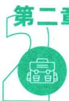

2.1 有理数的加法与减法 …… (14) (D9)
2.1.1 有理数的加法 …… (14) (D9)
课时1 有理数的加法 …… 刷基础 提升 (14) (D9)
课时2 有理数的加法运算律 …… 刷提升 (16) (D10)
2.1.2 有理数的减法 …… (17) (D11)
课时1 有理数的减法 …… 刷基础 (17) (D11)
课时2 有理数的加减混合运算 …… 刷基础 提升 (18) (D11)
2.2 有理数的乘法与除法 …… (20) (D12)
2.2.1 有理数的乘法 …… (20) (D12)
课时1 有理数的乘法 …… 刷基础 (20) (D12)
课时2 有理数的乘法运算律 …… 刷基础 提升 (21) (D13)
2.2.2 有理数的除法 …… (23) (D14)
课时1 有理数的除法 …… 刷基础 (23) (D14)
课时2 有理数的加减乘除混合运算 …… 刷基础 提升 (24) (D15)
重难专题1 巧用运算规律简化有理数的计算 …… 刷难关 (26) (D16)
2.3 有理数的乘方 …… (28) (D17)
2.3.1 乘方 …… (28) (D17)
课时1 有理数的乘方 …… 刷基础 (28) (D17)

## 新考法 新素材

研究对比全国近十年中考真题卷,发现各省市的中考会不断借鉴或探究新考法,同时会挖掘时事热点等新素材,创造新情境灵活考查知识点。中考是我们平时学习的风向标,因此我们需要关注新考法、新素材。

## 新考法

\- 绝对值与数轴相结合 ▶P8/T2
- 有理数减法法则的应用 ▶P17/T1
- 分配律的应用 ▶P22/T4
- 阅读材料型题目 ▶P61/T5
- 新定义“滑行方程”的应用 ▶P87/T13
- 角的和差运算 ▶P99/T7
- 角平分线的应用 ▶P101/T2

## 新素材

\- 以神舟十九号载人飞船为背景考查具有相反意义的量
- P1/T5
- 以《哪吒之魔童闹海》为背景考查科学记数法
- P37/T2

## ▶ 新考向 ◀

## 推荐理由

教育部发布的《关于加强初中学业水平考试命题工作的意见》中指出：弘扬中华优秀传统文化，提高探究性、开放性试题比例，积极探索跨学科命题，提高试题情境设计水平。结合《义务教育数学课程标准（2022年版）》新变化，通过分析全国百余套中考试题，发现以传统文化为背景的试题，以及探究性、开放性、综合性、跨学科试题在中考中出现得越来越频繁，故精选部分试题，让学生感受考向变化。

## 目录

课时2 含乘方的有理数混合运算 … 刷基础 提升 (29) (D17)
2.3.2 科学记数法 …… 刷基础 (31) (D18)
2.3.3 近似数 …… 刷基础 (32) (D19)
大招专题1 有关数轴的探索 …… 刷难关 (33) (D19)
数学活动 …… 刷活动 (34) (D21)
综合与实践 进位制的认识与探究 …… 刷实践 (35) (D21)
全章综合训练 …… 刷中考 章测 (36) (D21)

## 重难题型微课

## 第三章 代数式

3.1 列代数式表示数量关系 …… (39) (D24)
课时 1 代数式 …… 刷基础 (39) (D24)
课时 2 列代数式 …… 刷基础 提升 (40) (D24)
课时 3 正比例和反比例关系 …… 刷基础 提升 (42) (D25)
3.2 代数式的值 …… (44) (D26)
课时 1 代数式的值 …… 刷基础 (44) (D26)
课时 2 求代数式的值的应用 …… 刷基础 提升 (45) (D27)
数学活动 …… 刷活动 (47) (D28)
全章综合训练 …… 刷中考 章测 (48) (D28)

## 第四章 整式的加减

4.1 整式 …… (51) (D30)
课时 1 单项式 …… 刷基础 (51) (D30)
课时 2 多项式及整式 …… 刷基础 提升 (52) (D31)
重难专题 2 规律探索 …… 刷难关 (54) (D32)
4.2 整式的加法与减法 …… (55) (D33)
课时 1 同类项与合并同类项 …… 刷基础 (55) (D33)
课时 2 去括号 …… 刷基础 (56) (D33)
课时 3 整式的加减 …… 刷基础 提升 (57) (D34)
重难专题 3 整式的化简求值 …… 刷难关 (59) (D35)
数学活动 …… 刷活动 (61) (D36)

## 专题索引

## 微专题

微专题1 绝对值最值问题 P8
微专题2 整式中不含（无关）问题 P58
微专题3 解含绝对值的一元一次方程 P70
微专题4 线段计算中的特殊思想 P95

## 重难专题

重难专题1 巧用运算规律简化有理数的计算 P26
类型1 归类——同号相加,同分母相加
类型2 凑整——将和(积)为整数的数相结合
类型3 变序——方便约分和计算
类型4 组合——找出规律,重新组合,然后通过约分或抵消简化计算
类型5 拆分——将带分数拆分
类型6 裂项——拆项相消
类型7 换位——将被除数与除数颠倒位置
重难专题2 规律探索 P54
类型1 递推型规律探索
类型2 累加型规律探索
重难专题3 整式的化简求值 P59
类型1 化繁为简再求值
类型2 整体代入求值
类型3 整式化简中的“无关”问题
类型4 利用数形结合化简求值
重难专题4 特殊一元一次方程的解法技巧 P73
类型1 分子、分母化整
类型2 利用倒数关系去括号
类型3 整体思想的应用
类型4 先拆分,再合并

## 目录

全章综合训练·

累加型规律探索 P54T4 整式化简中的“无关”问题 P60T7

## 第五章 一元一次方程

5.1 方程 …… (64) (D38)
5.1.1 从算式到方程 …… 刷基础 (64) (D38)
5.1.2 等式的性质 …… 刷基础 提升 (65) (D38)
5.2 解一元一次方程 …… (67) (D39)
课时1 解一元一次方程 —— 合并同类项
…… 刷基础 (67) (D39)
课时2 解一元一次方程 —— 移项
…… 刷基础 (68) (D40)
课时3 解一元一次方程 —— 去括号
…… 刷基础 提升 (69) (D41)
课时4 解一元一次方程 —— 去分母
…… 刷基础 提升 (71) (D42)
重难专题4 特殊一元一次方程的解法技巧 … 刷难关 (73) (D44)
大招专题2 含参数的一元一次方程 …… 刷难关 (74) (D44)
5.3 实际问题与一元一次方程 …… (75) (D45)
课时1 产品配套问题与工程问题
…… 刷基础 提升 (75) (D45)
课时2 销售盈亏问题…… 刷基础 提升 (77) (D46)
课时3 积分问题与行程问题…… 刷基础 提升 (79) (D47)
课时4 分段计费问题与方案问题
…… 刷基础 提升 (81) (D49)
大招专题3 方程的应用——动点问题 …… 刷难关 (83) (D50)
数学活动 …… 刷活动 (84) (D51)
全章综合训练…… 刷中考 章测 (85) (D52)

## 重难题型微课

方程的恒解问题 P72T3 利用整体思想解方程 P73T6
工程问题 P76T1 行程问题 P80T2
方案问题 P82T2

## 专题索引

重难专题5 线段中的动态问题 P97
类型1 动点问题
类型2 动线段问题
类型3 定值问题

## 重难专题6 动角问题 P104

类型1 判断角的数量关系
类型2 求运动时间
类型3 定值问题

## 大招专题

大招专题1 有关数轴的探索 P33
母题学大招1 数轴中的折叠问题
母题学大招2 数轴上的循环规律问题
母题学大招3 数轴上数的变化规律问题

## 大招专题2 含参数的一元一次方程

母题学大招4 解的关系问题
母题学大招5 错解问题
母题学大招6 整数解问题
母题学大招7 解的个数问题

## 大招专题3 方程的应用——动点问题 P83

母题学大招8 距离问题
母题学大招9 相遇问题
母题学大招10 追及问题

大招专题4 与线段上的中点有关的计算 P96母题学大招11 双中点模型母题学大招12 三中点模型

## 大招专题5 双角平分线模型 P103

母题学大招13 两个角无公共部分
母题学大招14 两个角有公共部分
母题学大招15 三个角围成周角

## 第六章 几何图形初步

6.1 几何图形 …… (88) (D54)
6.1.1 立体图形与平面图形 …… (88) (D54)
课时 1 认识几何图形 …… 刷基础 (88) (D54)
课时 2 从不同的方向看物体及立体图形的展开图 …… 刷基础 提升 (89) (D54)
6.1.2 点、线、面、体 …… 刷基础 (91) (D55)
6.2 直线、射线、线段 …… (92) (D55)
6.2.1 直线、射线、线段 …… 刷基础 (92) (D55)
6.2.2 线段的比较与运算 …… 刷基础 提升 (93) (D56)
大招专题 4 与线段上的中点有关的计算 …… 刷难关 (96) (D58)
重难专题 5 线段中的动态问题 …… 刷难关 (97) (D59)
6.3 角 …… (98) (D60)
6.3.1 角的概念 …… 刷基础 (98) (D60)
6.3.2 角的比较与运算 …… (99) (D61)
课时 1 角的比较与运算 …… 刷基础 (99) (D61)
课时 2 角平分线 …… 刷基础 提升 (100) (D62)
6.3.3 余角和补角 …… 刷基础 (102) (D64)
大招专题 5 双角平分线模型 …… 刷难关 (103) (D64)
重难专题 6 动角问题 …… 刷难关 (104) (D66)
数学活动 …… 刷活动 (105) (D66)
综合与实践 设计学校田径运动会比赛场地 …… 刷实践 (106) (D67)
全章综合训练 …… 刷中考 章测 (107) (D67)

重难题型微课
根据平面图形还原几何体 P89T5

## 中考新考向备训

■新考向1 传统文化 ■新考向2 跨学科综合 ■新考向3 开放性试题
■新考向4 2022课标新增 ■新考向5 项目化学习

电子错题本鸭

## 知识点 1 正数和负数的概念

1[2025 河北秦皇岛校级期末]在数-3,0, $\frac{2}{3}$ , - $\frac{8}{5}$ ,3.7中,属于负数的有 ( )
A.1个 B.2个 C.3个 D.4个

2[2025 四川遂宁校级期末]下列语句中正确的是\_\_\_\_。(填序号)
①不带“-”号的数都是正数;②如果a是正数,那么-a一定是负数;③不存在既不是正数,也不是负数的数.

3 新考向传统文化 [2024 山西大同期末]算筹是我国古代的记数工具之一,摆法有纵式和横式两种,如下表所示. 古人在个位数上划上斜线以表示负数. 如“ $\pi=\pi_{k}$ ”表示-723. 则“ $\pi\perp\pi_{k}$ ”所表示的数是\_\_\_\_.

<table><tr><td>纵式</td><td>I</td><td>II</td><td>III</td><td>III</td><td>IIIIII</td><td>T</td><td> $\Pi$ </td><td>III</td><td>III</td></tr><tr><td>横式</td><td>-</td><td>=</td><td>≡</td><td>≡</td><td>≡</td><td>⊥</td><td>⊥</td><td>⊥</td><td>⊥</td></tr><tr><td>代表的数字</td><td>1</td><td>2</td><td>3</td><td>4</td><td>5</td><td>6</td><td>7</td><td>8</td><td>9</td></tr></table>

## 知识点 2 具有相反意义的量及表示方法

4 下列选项中是具有相反意义的量的是（）
A. 气温上升 $5^{\circ}$ C 和零下 $5^{\circ}$ C
B. 顺时针转 4 圈和逆时针转 3 圈
C. 盈利 200 元和支出 300 元
D. 走了 100 米和跑了 100 米

5 新素材 [2025 北京西城区校级期中] 2024 年 10 月 30 日, 搭载神舟十九号载人飞船的长征二号 F 遥十九运载火箭在酒泉卫星发射中心点火发射. 若火箭点火前 10 秒记为 -10 秒, 那么火箭点火后5秒应记为 （ ）A.-10秒 B.-5秒 C.+5秒 D.+10秒

6 新考向传统文化 [2024 江西南昌期中]《九章算术》中有“今两算得失相反,要令正负以名之”,意思是今有两数若其意义相反,则分别叫作正数与负数. 若收入 80 元记作+80 元,则-50 元表示\_\_\_\_.

7[2025 广东深圳期末]若深圳的纬度约是北纬 22.5 度,记作+22.5 度,则南极长城站的纬度约是南纬 62 度,记作\_\_\_\_度.

8[2024安徽铜陵期中]某空军大队举行特技飞行表演,其中一架飞机起飞0.5 km后完成4个表演动作,飞机的高度变化如下表所示.请补全下面表格:

<table><tr><td>动作</td><td>高度变化</td><td>记作</td></tr><tr><td>动作1</td><td>上升4.5km</td><td>+4.5km</td></tr><tr><td>动作2</td><td>下降3km</td><td>___</td></tr><tr><td>动作3</td><td>上升2km</td><td>___</td></tr><tr><td>动作4</td><td>下降2.5km</td><td>___</td></tr></table>

2 刷易错 小心有坑\~

## 易错点 对“0”的含义理解不清致错

9[2024 四川巴中质检]下列关于“0”的说法正确的个数是
( )
①0 是正数与负数的分界;
②0 只表示“什么也没有”;
③0 ℃ 表示没有温度;
④0 既不是正数,也不是负数;
⑤0 是自然数.
A. 2    B. 3    C. 4    D. 5

## 提升

1[2025 湖北武汉质检, 中]某粮店出售的三种品牌的面粉袋上分别标有质量为 $(20 \pm 0.1)$ kg, $(20 \pm 0.2)$ kg, $(20 \pm 0.3)$ kg 的字样, 从中任意拿出两袋, 它们的质量最多相差 ( )
A. 0.8 kg B. 0.6 kg C. 0.5 kg D. 0.4 kg

2[2025 浙江杭州质检, 中]某项科学研究, 以 45 分钟为一个时间单位, 并以每天上午 10 时为基准 0, 10 时以前记为负, 10 时以后记为正, 例如 9:15 记为 -1, 10:45 记为 +1, 则上午 7:45 应记为 ( )
A. +3 B. -3 C. -2.5 D. -7.5

3[中]日常生活中,许多具有相反意义的量都可以用正数、负数来表示.例如:一个杯子的杯口“朝上”可记作“+1”, 杯口“朝下”可记作“-1”.现在桌子上有11个杯口朝上的杯子,如果每次翻转3个,能否经过若干次翻转使这11个杯子的杯口全部朝下?若能,至少经过多少次翻转能使这11个杯子的杯口全部朝下?运用数学知识解决该问题,你的答案是 ( )
A.不能 B.能,4 C.能,5 D.能,6

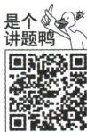

4[2025 江苏泰州质检, 中]下表列出了国外几个城市与北京的时差(带正号的数表示同一时刻比北京早的时数):

<table><tr><td>城市</td><td>纽约</td><td>伦敦</td><td>东京</td><td>巴黎</td></tr><tr><td>时差/时</td><td>-13</td><td>-8</td><td>+1</td><td>-7</td></tr></table>

如果北京时间是10月12日21时,那么伦敦的当地时间是\_\_\_\_.

5[中]某路公交车从起点经过A,B,C,D站到达终点,各站上下乘客的情况用“上车为正,下车为负”的方式表示,具体如下:起点(20,0),A(12,-4),B(8,-9),C(6,-4),D(2,-7),终点(0,\_\_\_\_).

6[中]快递分拣机器人从微博火到了朋友圈. 据介绍, 这些机器人不仅可以自动规划最优路线, 将包裹准确放入相应的格口, 还会感应避让障碍物、自动归队取包裹,没电的时候还会自己找充电桩充电.每台分拣机器人每小时可以分拣1.8万件包裹,大大提高了分拣效率.某分拣仓库计划平均每天分拣20万件包裹,但实际每天的分拣量与计划相比会有出入.下表是该仓库10月份第三周分拣包裹的情况(超过计划量记为正,未达到计划量记为负):

<table><tr><td>星期</td><td>一</td><td>二</td><td>三</td><td>四</td><td>五</td><td>六</td><td>日</td></tr><tr><td>分拣情况/万件</td><td>+6</td><td>-3</td><td>-4</td><td>+5</td><td>-1</td><td>+7</td><td>-8</td></tr></table>

(1)该仓库本周内分拣包裹数量最多的一天是星期\_\_\_\_，最少的一天是星期\_\_\_\_，最多的一天比最少的一天多分拣\_\_\_\_万件包裹；

(2)该仓库本周实际一共分拣包裹多少万件?

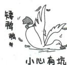
小心有坑

## 刷素养

7 核心素养运算能力[中]如图,将一串正负数按下列规律排列,有以下说法:

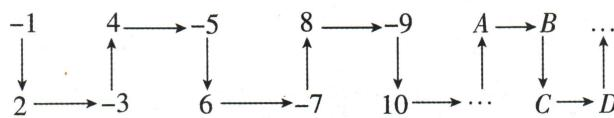

(1) 在 $A$ 处的数是正数；

(2)负数不可能排在A,B的位置;

(3) 排在 $C, D$ 处的数都是负数；

(4) 按以上顺序排列的第 2022 个数是正数.
其中说法正确的有
( )
A. 4 个 B. 3 个 C. 2 个 D. 1 个

# 1.2.1 有理数的概念

电子错题本鸭

## 知识点 1 有理数的概念

1 下列 7 个数中: $-\frac{7}{4}, 1.0010001, \frac{8}{33}, 0, \pi, -2.626626662 \cdots$ (每相邻两个 2 之间 6 的个数逐次加 1), $0.12$ , 有理数的个数是 ( )
A. 4 B. 5 C. 6 D. 7

2[2025 辽宁阜新期末]下列说法正确的是（）
A. 正整数和负整数统称为整数
B. 整数和分数统称为有理数
C. 非负有理数就是正有理数
D. 0 表示不存在, 所以 0 不是有理数

3 新考向开放性试题 请写出一个既是分数,又是负数的有理数: \_\_\_\_.

4[2025 河南许昌校级期中]祖冲之,我国南北朝时期著名的数学家、天文学家,他是世界上将圆周率精确到小数点后第七位的第一人,这一研究发现比西方早了约1 000年.他将圆周率的分数近似值 $\frac{355}{113}$ 称为密率, $\frac{22}{7}$ 称为约率.请判断约率 $\frac{22}{7}$ 是\_\_\_\_(填“有理数”或“无限不循环小数”).

## 知识点 2 有理数的分类

5[2025吉林白城期末]所有整数组成整数集合,所有负数组成负数集合,如图中的阴影部分也表示一个集合,则这个集合可以包含的有理数是()

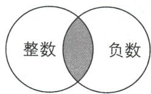

A. $-\frac{24}{7}$ B.-3 C.0 D.5.3

6 把下列各数填在相应的大括号里: 0,1,- $\frac{4}{5}$ ,
8.9,-7, $\frac{5}{6}$ ,-3.2,+1008,-0.06,28,-9, $\pi$ .
正整数: { … } ;
负整数: { … } ;
正分数: { … } ;
负分数: { … } ;
非负数: { … } ;
非正数: { … } ;
非负整数: { … } ;
非正整数: { … }.

7“有理数运动会”已经拉开序幕,每位有理数运动员要通过自己专属的检录通道,才能参加运动项目,请你作为志愿者带领以下有理数有秩序地进行检录(只填序号): ①- $\frac{5}{2021}$ ;②+0.007;③3 $\frac{2}{9}$ ;④0;⑤0.3;⑥10;⑦-44;⑧+101.

<table><tr><td colspan="4">运动会检录窗口</td></tr><tr><td>非负整数</td><td>正分数</td><td>负整数</td><td>负分数</td></tr><tr><td></td><td></td><td></td><td></td></tr></table>

8[2025 河北邢台质检]把下列各数填入表示它所在的集合的圈里(如图):
-0.72,-2,-98,25, $\frac{8}{3}$ ,6.3%,10,-3.14.

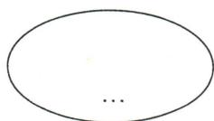

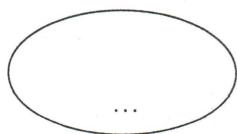
负整数

正整数
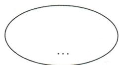
正分数

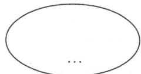
负分数

这四种数的集合合并在一起\_\_\_\_（填“是”或“不是”）全体有理数集合.

## 知识点 1 数轴的概念与画法

1 下列是四位同学所画的数轴,其中正确的是
( )
A. $\frac{1}{-2}$ $\frac{1}{-1}$ $\frac{1}{0}$ $\frac{1}{1}$ $\frac{1}{2}$ B. $\frac{1}{0}$ C. $\frac{1}{-3}$ $\frac{1}{-2}$ $\frac{1}{-1}$ $\frac{1}{0}$ $\frac{1}{1}$ D. $\frac{1}{2}$ $\frac{1}{1}$ $\frac{1}{-1}$ $\frac{1}{-2}$ $\frac{1}{3}$

2[2025 河北石家庄质检]有关数轴的画法,下列说法中,错误的是 ( )
A. 原点位置可以是数轴上任意一点
B. 一般情况下,取从左到右(或从下到上)的方向为数轴的正方向
C. 数轴的单位长度可根据实际需要任意选取
D. 数轴上每两个刻度之间的长度都等于1 cm

## 知识点 2 用数轴上的点表示有理数

3[2025 河南安阳期中]点 A 在数轴上的位置如图所示, 将点 A 在数轴上右移 7 个单位得到点 B, 则点 B 所表示的数为 ( )

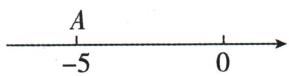

A. 7 B. 2 C. -7 D. -2

4[2025 北京西城区质检]如图的数轴部分被墨迹盖住,那么被盖住的点表示整数的有\_\_\_\_个.

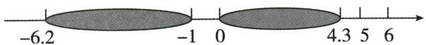

5[2025 江苏连云港质检]在数轴上画出表示下列各数的点:3,-2,0.5,0,-1 $\frac{1}{4}$ , $-\frac{1}{2}$ .

## 知识点 3 数轴上两点间的距离

6[2025 河南驻马店校级期末]如图, 点 O, A, B 在数轴上, 分别表示数 0, 1.5, 4.5, 数轴上另有

建议用时 20 分钟 答案 D3

一点 C, 到点 A 的距离为 1, 到点 B 的距离小于 3, 则点 C 位于
( )
A. 点 O 的左边    B. 点 O 与点 A 之间
C. 点 B 的右边    D. 点 A 与点 B 之间

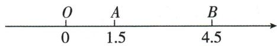

7[2025 山东聊城期中]如图,如果有理数 a 对应的点到原点的距离是 b 对应的点到原点的距离的 3 倍,那么 A,B,C,D 四点中可能是数轴的原点的是 \_\_\_\_.

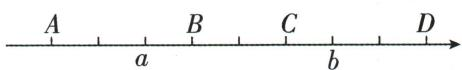

8 快递员骑车从快递公司出发, 先向北骑行 200 m 到达 A 小区, 继续向北骑行 400 m 到达 B 小区, 然后向南骑行 1000 m 到达 C 小区, 最后回到快递公司.

(1)以快递公司为原点,以向南为正方向,用1个单位长度表示100 m画出数轴,并在该数轴上表示出A,B,C三个小区的位置.

(2) $C$ 小区离 $B$ 小区有多远?

(3)快递员一共骑行了多少千米?

## 易错点 在数轴上根据距离求点表示的数时漏解

9 已知 A 和 B 都在同一条数轴上, 点 A 表示 -2, 点 B 和点 A 相距 5 个单位长度, 则点 B 表示的数是 \_\_\_\_.

1[2025江西上饶期末,中]在一条可以折叠的数轴上,点A,B表示的数分别是-10,3,如图(1),以点C为折点,将此数轴向右对折得到图(2),若点A在点B的右边,且AB=1,则点C表示的数是()

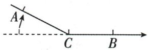

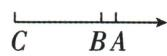

图(1) 图(2)
A. -4 B. -3 C. -1 D. 0

2[中]数轴上表示整数的点称为整点. 某数轴的单位长度为 $1 \mathrm{~cm}$ , 若在数轴上画出一条长为 $2023 \mathrm{~cm}$ 的线段 $AB$ , 则 $AB$ 盖住的整点个数是 ( )
A. 2023 或 2024 B. 2022 或 2023 C. 2024 D. 2023

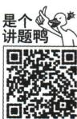

3[2025 河北邢台质检, 中]如图, 正方形 ABCD 在数轴上的位置如图所示, 点 D, A 对应的数分别为 -1 和 0, 若正方形 ABCD 在数轴上绕着顶点顺时针连续无滑动翻转, 翻转 1 次后, 点 B 在数轴上对应的数为 1. 在正方形 ABCD 连续翻转的过程中, 下列说法错误的是 ( )

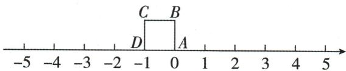

A. 翻转 3 次后, 点 D 与在数轴上表示 3 的点重合
B. 翻转 4 次后, 与数轴重合的两个顶点表示的数分别为 3 和 4
C. 在翻转过程中, 顶点 B 可与数轴上表示 14 的点重合
D. 连续翻转 2024 次后, 数轴上数 2024 所对应的点是 A

4[2024 河南郑州质检, 中]A, B, P 三个点中, 其中一点到另外两点的距离相等时, 我们称这三个点为“和谐三点”. 若数轴上三个不重合的点 A, B, P, 点 A 表示的数为 0, 点 B 表示的数为 4,点 P 在点 B 的左侧, 则“和谐三点” A, B, P 中的点 P 所对应的数为 \_\_\_\_.

## 刷素养

走向重高

5 核心素养推理能力 [2024 河南周口质检, 中] 李老师善于通过知识迁移, 对问题进行拓展探究, 培养同学们用数学的思维思考现实世界的能力. 下面是李老师在“数轴的实际应用”主题下设计的问题, 请你解答.

(1)知识回顾:如图(1),数轴上有一个表示数a的点M,已知点M在数轴上向右移动3个单位长度后表示的数是5,那么a的值是\_\_\_\_.

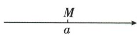
图(1)

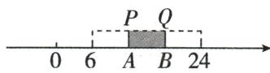
图(2)

(2) 探究迁移: 如图(2), 有一根木尺 PQ 放置在数轴上, 它的两端 P, Q 分别落在 A, B 两点处. 将木尺在数轴上水平移动, 当点 P 移动到点 B 时, 点 Q 所对应的数为 24; 当点 Q 移动到点 A 时, 点 P 所对应的数为 6 (单位: cm). 利用所学知识求出点 A、点 B 所表示的数及木尺 PQ 的长.

(3)拓展应用:一天,小明去问爷爷的年龄.爷爷说:“我若是你现在这么大,你还要40年才出生呢;你若是我现在这么大,我已经是116岁了!”请你利用(2)的方法,求出小明和爷爷的年龄.

## 知识点 1 相反数的概念及性质

1[2025 江苏宿迁期中] $-\frac{1}{2025}$ 的相反数是（）
A. $\frac{1}{2025}$ B. $-\frac{1}{2025}$ C.-2025 D.2025

2[2025 江苏无锡质检]下列说法正确的是
( )
A. $-\frac{1}{2}$ 与+2互为相反数
B. 5 的相反数是+5
C. 数轴上表示-a 的点一定在原点的左边
D. 任何负数的相反数都是正数

3 $\frac{2}{3}$ 和它的相反数之间的整数有\_\_\_\_个.

4 如图, 数轴上 A, B 两点表示的数互为相反数, 且点 A 与点 B 之间的距离为 4 个单位长度, 则点 A 表示的数是 \_\_\_\_.

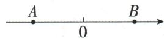

5[2024 新疆喀什期中]如图, 图中数轴的单位长度为 1. 请回答下列问题:
(1) 如果点 A, B 表示的数互为相反数, 那么点 C 表示的数是多少?
(2) 如果点 D, B 表示的数互为相反数, 那么点 C, D 表示的数是多少?

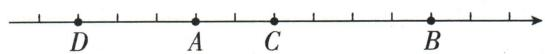

## 知识点 2 利用相反数的意义化简

6 若 $-(+a)=+(-2)$ ，则 a 的值是
A. $\frac{1}{2}$ B. $-\frac{1}{2}$ C.2 D.-2

7 已知 $-\left[-(+x)\right]=8$ ，则 $x$ 的相反数是 \_\_\_\_.

8 如果 a 的相反数是最大的负整数, b 的相反数是最小的正整数, 那么数轴上 a, b 所对应的点之间相差 \_\_\_\_ 个单位长度.

9 化简下列各数：
(1) $-(+10)$ ; (2) $+(-0.15)$ ;
(3) $+(+3)$ ; (4) $-(-20)$ ;
(5) $-\left(-\frac{2}{3}\right)$ ; (6) $-\left[-\left(+2\frac{1}{5}\right)\right]$ ;

(7) $+\left\{-\left[+\left(-0.03\right)\right]\right\}$ .

10[2025 山西太原质检]化简下列各式的符号，并回答问题：
(1) $-(+4)$ ;
(2) $+\left(-\frac{3}{7}\right)$ ;
(3) $-\left[-\left(-3\frac{2}{5}\right)\right]$ ;
(4) $-\left\{-\left[-(-2024)\right]\right\}$ .
化简结果的符号与原式中的“-”号的个数有什么关系？

电子错题本鸭

## 知识点 1 绝对值的定义

1 如图, 数轴上有 A, B, C, D 四个点, 其中表示的数的绝对值等于 2 的点是 ( )
A. 点 A    B. 点 B    C. 点 C    D. 点 D

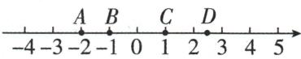

2 求下列各数的绝对值: $-\frac{1}{2}, 0.5, -4 \frac{1}{3}$ .

3[2024 河南周口期中]若 $|a| = -a$ ，则 a 是( )
A. 正数或 0    B. 0
C. 负数或 0    D. 正数

## 知识点 2 绝对值的性质

4[2025江西吉安期末]下列说法中,正确的是
( )
A.一个有理数的绝对值不小于它自身
B.若两个有理数的绝对值相等,则这两个数相等
C.若两个有理数的绝对值相等,则这两个数互为相反数
D.-a的绝对值等于a

5[2025 浙江温州校级期中]若 $|x-3|+|y-4|=0$ ,
x=\_\_\_\_, y=\_\_\_\_.

6 式子 $|x-1|+5$ 的最小值是 \_\_\_\_.

7 小贝认为: 若有理数 a, b 满足 $\left|a\right| > \left|b\right|$ ，则 a > b.
小贝的观点正确吗？请说明理由.

## 知识点 3 绝对值的化简

8[2024 四川成都期末]已知-3<x<3,下列四个结论中,正确的是
A. $|x|>3$ B. $|x|\leqslant3$ C. $0\leqslant|x|<3$ D. $0<|x|<3$

9 已知 $a = -2, b = 1$ ，则 $|a| + |-b|$ 的值为 \_\_\_\_.

10 计算: +|-4|-|-2.5|+|-(-3)|.

## 2 刷易错 小心有坑\~

## 易错点 忽略0也是绝对值等于本身的数而致错

11 判断: 若 $\left|m\right|=m$ , 则 m 是正数.
晓莉认为上述说法正确,请你判断晓莉的想法是否正确,如果不正确,请举出例子说明理由.

## 刷|提升

1[中]设 a 是不为零的有理数,那么 $x=\frac{a}{|a|}$ 的不同取值共有
( )
A. 1 种 B. 2 种 C. 3 种 D. 4 种

2 新考法[2025 福建福州期中, 中]如图, M, N, P, R 分别是数轴上四个整数所对应的点, 其中有一点是原点, 并且 MN = NP = PR = 1. 数 a 对应的点在 M 与 N 之间, 数 b 对应的点在 P 与 R 之间. 若 $\left|a\right| + \left|b\right| = 2$ , 则原点是 ( )

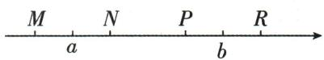

A. $M$ 或 $N$ B. $M$ 或 $R$ C. $N$ 或 $P$ D. $P$ 或 $R$

3[中]已知零件的标准直径是100 mm,超过标准直径的数量记作正数,不足标准直径的数量记作负数,检验员抽查了五件样品,检查结果如下:

<table><tr><td>序号</td><td>1</td><td>2</td><td>3</td><td>4</td><td>5</td></tr><tr><td>直径(mm)</td><td>+0.10</td><td>-0.15</td><td>+0.20</td><td>-0.05</td><td>+0.25</td></tr></table>

(1)指出哪件样品的直径最符合要求;

(2)如果规定误差的绝对值在0.18 mm之内是正品,误差的绝对值在0.18\~0.22 mm之间是次品,误差的绝对值超过0.22 mm是废品,那么这五件样品分别属于哪类产品?

## 微专题1 绝对值最值问题

4[2025 江苏苏州质检,较难]数轴上点 A, B 分别表示有理数 a, b, AB 表示 A, B 两点之间的距离, 则 AB = |a - b|. 例如: 数轴上表示数 2 和 5 的两点之间的距离为 |2 - 5| = 3; 数轴上表示数 3 和 -1 的两点之间的距离为 |3 - (-1)| = 4. 又如: |x + 2| 可以写成 |x - (-2)|, 它的几何意义是数轴上表示数 x 的点与表示数 -2 的点之间的距离.

(1) 和为定值 $\left|x+2\right|+\left|x-3\right|$ 表示数轴上有理数 x 对应的点到 -2 和 3 对应的两点距离之和. 请你利用数轴, 写出所有符合条件的整数 x, 使得 $\left|x+2\right|+\left|x-3\right|=5$ .

(2) 偶数个绝对值之和最小 ① $|x+3|+|x-4|$ 的最小值是 \_\_\_\_，此时 x 的取值范围是 \_\_\_\_。

②代数式 $|x+7|+|x+4|+|x-2|+|x-5|$ 的最小值是\_\_\_\_，此时x的取值范围是\_\_\_\_。

(3) 奇数个绝对值之和最小 ① $|x+6|+|x+3|+ |x-2|$ 的最小值是\_\_\_\_, 此时 $x$ 的值是\_\_\_\_.

② $|x-1|+|x-2|+|x-3|+\cdots+|x-617|$ 取最小值时 x 的值是 \_\_\_\_.

电子错题本鸭

建议用时 20 分钟 答案 D6

## 知识点 1 利用数轴比较有理数的大小

1[2024广东东莞期中]如图所示,已知数轴上两数a和b,下列关系正确的是 ( )
A. a<-b<b<-a
B. -a<-b<a<b
C. -b<-a<a<b
D. a<b<-b<-a

2 如图, 数轴上 A 点表示的数是 a, 写出一个比 a 大的负分数: \_\_\_\_.

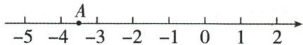

3[2025 上海浦东新区期中]在如图所示的数轴上表示下列各数,并用“<”把这些数连接起来.
-3,3.5,- $\left(-2\frac{1}{2}\right)$ , -1-1|.

<table><tr><td>-5</td><td>-4</td><td>-3</td><td>-2</td><td>-1</td><td>0</td><td>1</td><td>2</td><td>3</td><td>4</td><td>5</td></tr></table>

## 知识点 2 利用绝对值比较有理数的大小

4[2025黑龙江佳木斯期末]如果甲数的绝对值比乙数的绝对值大,那么 ( )
A. 甲数一定大于乙数
B. 乙数一定大于甲数
C. 这两个数不可能都大于0
D. 无法判断

5 比较大小: $-\frac{2}{3}$ 和 $-\frac{3}{4}$ .

## 知识点 3 有理数大小的比较

6 下列选项的四个数中, 最小的数是 ( )
A. $-(-1)$ B. $-(+2)$ C. $|-3|$ D. 0

7 下列四个式子: ①-3.8> $-\left(+3\frac{3}{4}\right)$ ; ② $-\left(-\frac{3}{4}\right)>$ $-\left(-\frac{3}{5}\right)$ ; ③ |-2.5|>-2.5; ④ $-\left(-5\frac{1}{2}\right)>$ $\left|+5\frac{2}{3}\right|$ . 正确的是
( )
A. ③④ B. ①③ C. ①② D. ②③

8 大于-2 且不大于 3 的整数有 \_\_\_\_ 个.

## 2刷素养→走向重高

9 核心素养几何直观 如图所示, 数轴上的点 A, B, C,
D 表示的数分别是 -1.5, -3, 2, 3.5.

<table><tr><td>-4</td><td>-3</td><td>-2</td><td>-1</td><td>0</td><td>1</td><td>2</td><td>3</td><td>4</td></tr></table>

(1) 将 $A, B, C, D$ 表示的数按从小到大的顺序用“<”连接起来.

(2)若将原点改在 C 点,则 A,B,C,D 点所对应的数分别为多少? 将这些数按从小到大的顺序用“<”连接起来.

(3) 改变原点位置后, 点 A, B, C, D 所表示的数的大小顺序改变了吗? 这说明了数轴的什么性质?

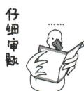

电子错题本鸭

## 活动

![[初中/课堂同步/教辅/必刷题/2026版《初中必刷题》数学 RJ  7上/01_第一章_有理数/数学活动/数学活动.md]]
![[初中/课堂同步/教辅/必刷题/2026版《初中必刷题》数学 RJ  7上/01_第一章_有理数/全章综合训练/刷中考.md]]
![[初中/课堂同步/教辅/必刷题/2026版《初中必刷题》数学 RJ  7上/01_第一章_有理数/全章综合训练/刷章测.md]]
![[初中/课堂同步/教辅/必刷题/2026版《初中必刷题》数学 RJ  7上/02_第二章_有理数的运算/课时1_有理数的加法/刷基础.md]]
![[初中/课堂同步/教辅/必刷题/2026版《初中必刷题》数学 RJ  7上/02_第二章_有理数的运算/课时1_有理数的加法/刷提升.md]]
![[初中/课堂同步/教辅/必刷题/2026版《初中必刷题》数学 RJ  7上/02_第二章_有理数的运算/课时2_有理数的加法运算律/课时2_有理数的加法运算律.md]]
![[初中/课堂同步/教辅/必刷题/2026版《初中必刷题》数学 RJ  7上/02_第二章_有理数的运算/课时1_有理数的减法/课时1_有理数的减法.md]]
![[初中/课堂同步/教辅/必刷题/2026版《初中必刷题》数学 RJ  7上/02_第二章_有理数的运算/课时2_有理数的加减混合运算/刷基础.md]]
![[初中/课堂同步/教辅/必刷题/2026版《初中必刷题》数学 RJ  7上/02_第二章_有理数的运算/课时2_有理数的加减混合运算/刷提升.md]]
![[初中/课堂同步/教辅/必刷题/2026版《初中必刷题》数学 RJ  7上/02_第二章_有理数的运算/课时1_有理数的乘法/课时1_有理数的乘法.md]]
![[初中/课堂同步/教辅/必刷题/2026版《初中必刷题》数学 RJ  7上/02_第二章_有理数的运算/课时2_有理数的乘法运算律/刷基础.md]]
![[初中/课堂同步/教辅/必刷题/2026版《初中必刷题》数学 RJ  7上/02_第二章_有理数的运算/课时2_有理数的乘法运算律/刷提升.md]]
![[初中/课堂同步/教辅/必刷题/2026版《初中必刷题》数学 RJ  7上/02_第二章_有理数的运算/课时1_有理数的除法/课时1_有理数的除法.md]]
![[初中/课堂同步/教辅/必刷题/2026版《初中必刷题》数学 RJ  7上/02_第二章_有理数的运算/课时2_有理数的加减乘除混合运算/刷基础.md]]
![[初中/课堂同步/教辅/必刷题/2026版《初中必刷题》数学 RJ  7上/02_第二章_有理数的运算/课时2_有理数的加减乘除混合运算/刷提升.md]]
![[初中/课堂同步/教辅/必刷题/2026版《初中必刷题》数学 RJ  7上/02_第二章_有理数的运算/重难专题1_巧用运算规律简化有理数的计算/重难专题1_巧用运算规律简化有理数的计算.md]]
![[初中/课堂同步/教辅/必刷题/2026版《初中必刷题》数学 RJ  7上/02_第二章_有理数的运算/课时1_有理数的乘方/课时1_有理数的乘方.md]]
![[初中/课堂同步/教辅/必刷题/2026版《初中必刷题》数学 RJ  7上/02_第二章_有理数的运算/课时2_含乘方的有理数混合运算/刷基础.md]]
![[初中/课堂同步/教辅/必刷题/2026版《初中必刷题》数学 RJ  7上/02_第二章_有理数的运算/课时2_含乘方的有理数混合运算/刷提升.md]]
![[初中/课堂同步/教辅/必刷题/2026版《初中必刷题》数学 RJ  7上/02_第二章_有理数的运算/大招专题1_有关数轴的探索/大招专题1_有关数轴的探索.md]]
![[初中/课堂同步/教辅/必刷题/2026版《初中必刷题》数学 RJ  7上/02_第二章_有理数的运算/数学活动/数学活动.md]]
![[初中/课堂同步/教辅/必刷题/2026版《初中必刷题》数学 RJ  7上/02_第二章_有理数的运算/综合与实践_进位制的认识与探究/综合与实践_进位制的认识与探究.md]]
![[初中/课堂同步/教辅/必刷题/2026版《初中必刷题》数学 RJ  7上/02_第二章_有理数的运算/全章综合训练/刷中考.md]]
![[初中/课堂同步/教辅/必刷题/2026版《初中必刷题》数学 RJ  7上/02_第二章_有理数的运算/全章综合训练/刷章测.md]]
![[初中/课堂同步/教辅/必刷题/2026版《初中必刷题》数学 RJ  7上/03_第三章_代数式/课时_1_代数式/课时_1_代数式.md]]
![[初中/课堂同步/教辅/必刷题/2026版《初中必刷题》数学 RJ  7上/03_第三章_代数式/课时_2_列代数式/刷基础.md]]
![[初中/课堂同步/教辅/必刷题/2026版《初中必刷题》数学 RJ  7上/03_第三章_代数式/课时_2_列代数式/刷提升.md]]
![[初中/课堂同步/教辅/必刷题/2026版《初中必刷题》数学 RJ  7上/03_第三章_代数式/课时_3_正比例和反比例关系/刷基础.md]]
![[初中/课堂同步/教辅/必刷题/2026版《初中必刷题》数学 RJ  7上/03_第三章_代数式/课时_3_正比例和反比例关系/刷提升.md]]
![[初中/课堂同步/教辅/必刷题/2026版《初中必刷题》数学 RJ  7上/03_第三章_代数式/课时_1_代数式的值/课时_1_代数式的值.md]]
![[初中/课堂同步/教辅/必刷题/2026版《初中必刷题》数学 RJ  7上/03_第三章_代数式/课时_2_求代数式的值的应用/刷基础.md]]
![[初中/课堂同步/教辅/必刷题/2026版《初中必刷题》数学 RJ  7上/03_第三章_代数式/课时_2_求代数式的值的应用/刷提升.md]]
![[初中/课堂同步/教辅/必刷题/2026版《初中必刷题》数学 RJ  7上/03_第三章_代数式/数学活动/数学活动.md]]
![[初中/课堂同步/教辅/必刷题/2026版《初中必刷题》数学 RJ  7上/03_第三章_代数式/全章综合训练/刷中考.md]]
![[初中/课堂同步/教辅/必刷题/2026版《初中必刷题》数学 RJ  7上/03_第三章_代数式/全章综合训练/刷章测.md]]
![[初中/课堂同步/教辅/必刷题/2026版《初中必刷题》数学 RJ  7上/04_第四章_整式的加减/课时_1_单项式/课时_1_单项式.md]]
![[初中/课堂同步/教辅/必刷题/2026版《初中必刷题》数学 RJ  7上/04_第四章_整式的加减/课时_2_多项式及整式/刷基础.md]]
![[初中/课堂同步/教辅/必刷题/2026版《初中必刷题》数学 RJ  7上/04_第四章_整式的加减/课时_2_多项式及整式/刷提升.md]]
![[初中/课堂同步/教辅/必刷题/2026版《初中必刷题》数学 RJ  7上/04_第四章_整式的加减/重难专题_2_规律探索/重难专题_2_规律探索.md]]
![[初中/课堂同步/教辅/必刷题/2026版《初中必刷题》数学 RJ  7上/04_第四章_整式的加减/课时_1_同类项与合并同类项/课时_1_同类项与合并同类项.md]]
![[初中/课堂同步/教辅/必刷题/2026版《初中必刷题》数学 RJ  7上/04_第四章_整式的加减/课时_2_去括号/课时_2_去括号.md]]
![[初中/课堂同步/教辅/必刷题/2026版《初中必刷题》数学 RJ  7上/04_第四章_整式的加减/课时_3_整式的加减/刷基础.md]]
![[初中/课堂同步/教辅/必刷题/2026版《初中必刷题》数学 RJ  7上/04_第四章_整式的加减/课时_3_整式的加减/刷提升.md]]
![[初中/课堂同步/教辅/必刷题/2026版《初中必刷题》数学 RJ  7上/04_第四章_整式的加减/重难专题_3_整式的化简求值/重难专题_3_整式的化简求值.md]]
![[初中/课堂同步/教辅/必刷题/2026版《初中必刷题》数学 RJ  7上/04_第四章_整式的加减/数学活动/数学活动.md]]
![[初中/课堂同步/教辅/必刷题/2026版《初中必刷题》数学 RJ  7上/05_第五章_一元一次方程/课时1_解一元一次方程____合并同类项/课时1_解一元一次方程____合并同类项.md]]
![[初中/课堂同步/教辅/必刷题/2026版《初中必刷题》数学 RJ  7上/05_第五章_一元一次方程/课时2_解一元一次方程____移项/课时2_解一元一次方程____移项.md]]
![[初中/课堂同步/教辅/必刷题/2026版《初中必刷题》数学 RJ  7上/05_第五章_一元一次方程/课时3_解一元一次方程____去括号/刷基础.md]]
![[初中/课堂同步/教辅/必刷题/2026版《初中必刷题》数学 RJ  7上/05_第五章_一元一次方程/课时3_解一元一次方程____去括号/刷提升.md]]
![[初中/课堂同步/教辅/必刷题/2026版《初中必刷题》数学 RJ  7上/05_第五章_一元一次方程/课时4_解一元一次方程____去分母/刷基础.md]]
![[初中/课堂同步/教辅/必刷题/2026版《初中必刷题》数学 RJ  7上/05_第五章_一元一次方程/课时4_解一元一次方程____去分母/刷提升.md]]
![[初中/课堂同步/教辅/必刷题/2026版《初中必刷题》数学 RJ  7上/05_第五章_一元一次方程/重难专题4_特殊一元一次方程的解法技巧/重难专题4_特殊一元一次方程的解法技巧.md]]
![[初中/课堂同步/教辅/必刷题/2026版《初中必刷题》数学 RJ  7上/05_第五章_一元一次方程/大招专题2_含参数的一元一次方程/大招专题2_含参数的一元一次方程.md]]
![[初中/课堂同步/教辅/必刷题/2026版《初中必刷题》数学 RJ  7上/05_第五章_一元一次方程/课时1_产品配套问题与工程问题/刷基础.md]]
![[初中/课堂同步/教辅/必刷题/2026版《初中必刷题》数学 RJ  7上/05_第五章_一元一次方程/课时1_产品配套问题与工程问题/刷提升.md]]
![[初中/课堂同步/教辅/必刷题/2026版《初中必刷题》数学 RJ  7上/05_第五章_一元一次方程/课时2_销售盈亏问题/刷基础.md]]
![[初中/课堂同步/教辅/必刷题/2026版《初中必刷题》数学 RJ  7上/05_第五章_一元一次方程/课时2_销售盈亏问题/刷提升.md]]
![[初中/课堂同步/教辅/必刷题/2026版《初中必刷题》数学 RJ  7上/05_第五章_一元一次方程/课时3_积分问题与行程问题/刷基础.md]]
![[初中/课堂同步/教辅/必刷题/2026版《初中必刷题》数学 RJ  7上/05_第五章_一元一次方程/课时3_积分问题与行程问题/刷提升.md]]
![[初中/课堂同步/教辅/必刷题/2026版《初中必刷题》数学 RJ  7上/05_第五章_一元一次方程/课时4_分段计费问题与方案问题/刷基础.md]]
![[初中/课堂同步/教辅/必刷题/2026版《初中必刷题》数学 RJ  7上/05_第五章_一元一次方程/课时4_分段计费问题与方案问题/刷提升.md]]
![[初中/课堂同步/教辅/必刷题/2026版《初中必刷题》数学 RJ  7上/05_第五章_一元一次方程/大招专题3_方程的应用__动点问题/大招专题3_方程的应用__动点问题.md]]
![[初中/课堂同步/教辅/必刷题/2026版《初中必刷题》数学 RJ  7上/05_第五章_一元一次方程/数学活动/数学活动.md]]
![[初中/课堂同步/教辅/必刷题/2026版《初中必刷题》数学 RJ  7上/05_第五章_一元一次方程/全章综合训练/刷中考.md]]
![[初中/课堂同步/教辅/必刷题/2026版《初中必刷题》数学 RJ  7上/05_第五章_一元一次方程/全章综合训练/刷章测.md]]
![[初中/课堂同步/教辅/必刷题/2026版《初中必刷题》数学 RJ  7上/06_第六章_几何图形初步/课时_1_认识几何图形/课时_1_认识几何图形.md]]
![[初中/课堂同步/教辅/必刷题/2026版《初中必刷题》数学 RJ  7上/06_第六章_几何图形初步/课时_2_从不同的方向看物体及立体图形的展开图/刷基础.md]]
![[初中/课堂同步/教辅/必刷题/2026版《初中必刷题》数学 RJ  7上/06_第六章_几何图形初步/课时_2_从不同的方向看物体及立体图形的展开图/刷提升.md]]
![[初中/课堂同步/教辅/必刷题/2026版《初中必刷题》数学 RJ  7上/06_第六章_几何图形初步/大招专题_4_与线段上的中点有关的计算/大招专题_4_与线段上的中点有关的计算.md]]
![[初中/课堂同步/教辅/必刷题/2026版《初中必刷题》数学 RJ  7上/06_第六章_几何图形初步/重难专题_5_线段中的动态问题/重难专题_5_线段中的动态问题.md]]
![[初中/课堂同步/教辅/必刷题/2026版《初中必刷题》数学 RJ  7上/06_第六章_几何图形初步/课时_1_角的比较与运算/课时_1_角的比较与运算.md]]
![[初中/课堂同步/教辅/必刷题/2026版《初中必刷题》数学 RJ  7上/06_第六章_几何图形初步/课时_2_角平分线/刷基础.md]]
![[初中/课堂同步/教辅/必刷题/2026版《初中必刷题》数学 RJ  7上/06_第六章_几何图形初步/课时_2_角平分线/刷提升.md]]
![[初中/课堂同步/教辅/必刷题/2026版《初中必刷题》数学 RJ  7上/06_第六章_几何图形初步/大招专题_5_双角平分线模型/大招专题_5_双角平分线模型.md]]
![[初中/课堂同步/教辅/必刷题/2026版《初中必刷题》数学 RJ  7上/06_第六章_几何图形初步/重难专题_6_动角问题/重难专题_6_动角问题.md]]
![[初中/课堂同步/教辅/必刷题/2026版《初中必刷题》数学 RJ  7上/06_第六章_几何图形初步/数学活动/数学活动.md]]
![[初中/课堂同步/教辅/必刷题/2026版《初中必刷题》数学 RJ  7上/06_第六章_几何图形初步/综合与实践_设计学校田径运动会比赛场地/综合与实践_设计学校田径运动会比赛场地.md]]
![[初中/课堂同步/教辅/必刷题/2026版《初中必刷题》数学 RJ  7上/06_第六章_几何图形初步/全章综合训练/刷中考.md]]
![[初中/课堂同步/教辅/必刷题/2026版《初中必刷题》数学 RJ  7上/06_第六章_几何图形初步/全章综合训练/刷章测.md]]
