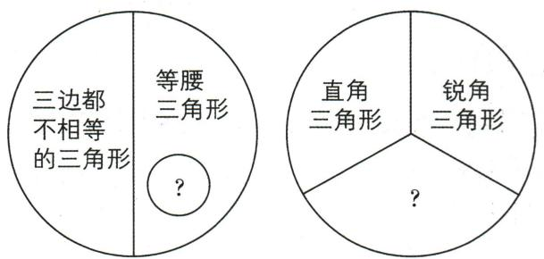

<!-- question-source:start -->
4[2025 黑龙江哈尔滨期中]如图,将三角形分别按边的相等关系和角的大小分类,则两处“?”分别为()

建议用时 20 分钟 答案 D1

A.等边三角形，等腰直角三角形B.等腰直角三角形，钝角三角形C.等边三角形，钝角三角形D.锐角三角形，等边三角形
<!-- question-source:end -->

![[Q00103252A1]]
