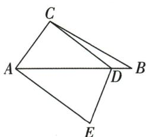

<!-- question-source:start -->
7 AI DPSK 原创 如图, 已知 $\angle CAE = \angle ACD = 90^{\circ}$ , $\angle ADE < \angle E < \angle ACD$ , 请写出图中的锐角三角形、直角三角形和钝角三角形.

<!-- question-source:end -->

![[Q00103255A1]]
