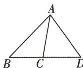
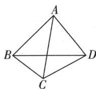

> [!success]- 必刷题
>
> > [!success] **【答案】** 详见解析
>
> > [!note]- **【解析】**
> > 【解】按点共线分类,可分为三种情形:
> >
> > (1) 四点共线: 四个点 A, B, C, D 在同一条直线上, 不能组成三角形;
> >
> > (2)三点共线:四个点A,B,C,D中有且仅有三个点(例如B,C,D)在同一条直线上,如图(1)所示,可组成三个三角
> >
> > 
> > 图(1)
> >
> > $$
> > \triangle A B C, \triangle A C D, \triangle A B D
> > $$
> >
> > (3)任意三点不共线:四个点A,B,C,D中任意三个点都不在同一条直线上,如图(2)所示,可组成四个三角形,分别是 $\triangle ABC,\triangle ABD,\triangle ACD,\triangle BCD.$
> >
> > 
> > 图(2)
