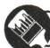

> [!success]- 必刷题
>
> > [!success] **【答案】** 详见解析
>
> > [!note]- **【解析】**
> > 【解】锐角三角形： $\triangle AED$ ，直角三角形： $\triangle ACD$ ，钝角三角形： $\triangle ABC$ ， $\triangle BDC$ .
> >
> > ## 13.2 与三角形有关的线段
> >
> > ## 13.2.1 三角形的边
> >
> > 
