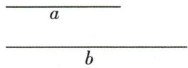

<!-- question-source:start -->
2[2024 山西太原期中]王老师有长度分别为 a, b 的两根小棒(如图), 如果要把其中的一根剪成两段, 那么在下列选项的剪法中, 三根小棒一定能围成三角形的是 ( )

A. 将长为 $a$ 的小棒正中间剪一刀
B. 将长为 $b$ 的小棒正中间剪一刀
C. 将长为 $a$ 的小棒任意剪一刀
D. 将长为 $b$ 的小棒任意剪一刀
<!-- question-source:end -->

![[Q00103257A1]]
