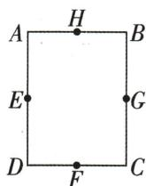
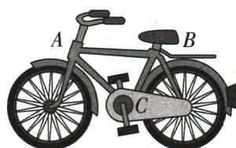

<!-- question-source:start -->
7[2024 贵州遵义期中]如图,工人师傅做了一个长方形窗框 ABCD, E, F, G, H 分别是四条边上的中点,为了使它更加稳固,需要在窗框上钉一根木条,这根木条不应钉在 ( )
A. A, G 两点处    B. G, H 两点处
C. B, F 两点处    D. E, G 两点处

(第7题图)

(第8题图)
<!-- question-source:end -->

![[Q00103262A1]]
