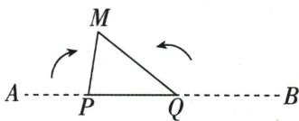

<!-- question-source:start -->
3[2025 河北邯郸质检, 中] 如图, 一根直的铁丝 AB = 20 cm, 欲将其弯折成一个三角形, 在同一平面内操作如下:

①量出 ${AP} = 5\mathrm{\;{cm}}$ ；

②在点 P 右侧取一点 Q, 使 PQ > 5 cm;

③将 ${AP}$ 向右翻折, ${BQ}$ 向左翻折.

若要使 A, B 两点能在点 M 处重合, 则 PQ 的长度可能是
( )
A. 12 cm B. 11 cm C. 10 cm D. 7 cm
<!-- question-source:end -->

![[Q00103267A1]]
