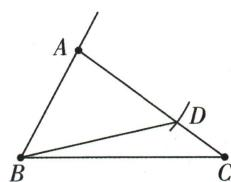
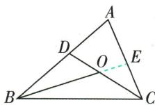

> [!success]- 必刷题
>
> > [!success] **【答案】** $>$
>
> > [!note]- **【解析】**
> > 
> > 【证明】延长 $BO$ 交 $AC$ 于点 $E$ , 如图.
> >
> > 
> >
> > 在 $\triangle EOC$ 中， $EO + EC > OC$ $\therefore EO + EC + OB > OC + OB,$ 即 $EB + EC > OC + OB.$ 在 $\triangle ABE$ 中， $AB + AE > EB$ $\therefore AB + AE + EC > EB + EC,$ 即 $AB + AC > EB + EC,$ $\therefore AB + AC > OB + OC.$
