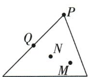
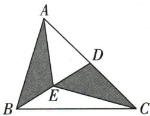
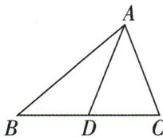

<!-- question-source:start -->
1[2024 湖北武汉期末]如图,有一个厚薄均匀的三角形硬纸板,在硬纸板上选一点,并钻一个小孔,穿过小孔系一条线将硬纸板吊起,若三角形硬纸板处于平衡状态,则这一点可能是( )
A. N 点 B. M 点 C. P 点 D. Q 点

(第1题图)
(第2题图)

(第3题图)
<!-- question-source:end -->

![[Q00103272A1]]
