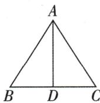
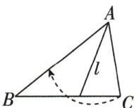

<!-- question-source:start -->
4[2025 河南周口期末]若 AD 是 $\triangle ABC$ 的角平分线(如图所示), 则下列结论不正确的是()
A. AD 平分 $\angle BAC$ B. $\angle BAD = \angle CAD$ C. BD = CD D. $\angle BAC = 2\angle BAD$

(第4题图)
(第6题图)
<!-- question-source:end -->

![[Q00103275A1]]
