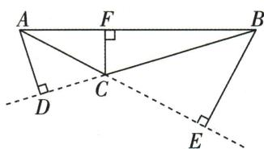
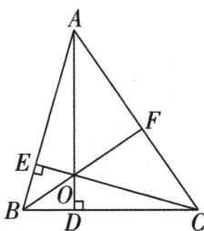

<!-- question-source:start -->
8[2025 广东惠州期中]如图,在 $\triangle ABC$ 中,关于高的说法正确的是
( )
A.线段 $AD$ 是 $BC$ 边上的高
B.线段 $BE$ 是 $AB$ 边上的高
C.线段 $CF$ 是 $AC$ 边上的高
D.线段 $CF$ 是 $BC$ 边上的高

(第8题图)
(第 10 题图)
<!-- question-source:end -->

![[Q00103279A1]]
