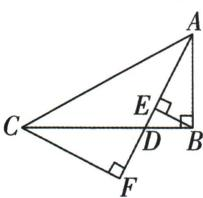
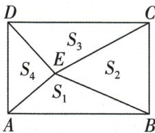

<!-- question-source:start -->
1[2024 北京海淀区期中, 中]如图, 在直角三角形 $ABC$ 中, $\angle ABC = 90^{\circ}$ , 点 $D$ 沿 $CB$ 自点 $C$ 向点 $B$ 运动 (点 $D$ 与点 $C, B$ 不重合), 作 $BE \perp AD$ 于点 $E, CF \perp AD$ 的延长线于点 $F$ , 在点 $D$ 的运动过程中, $BE + CF$ 的值逐渐 ( )

A. 变小

B. 变大

C. 不变

D. 无法确定

(第1题图)

(第2题图)
<!-- question-source:end -->

![[Q00103282A1]]
