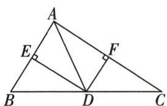
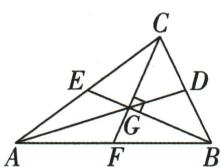

<!-- question-source:start -->
3[中]如图,在 $\triangle ABC$ 中, $AD$ 为 $BC$ 边上的中线, $DE \perp AB$ 于点 $E,DF \perp AC$ 于点 $F,AB=3,AC=4,DF=1.5$ ,则 $DE=$ \_\_\_\_.

(第3题图)

(第4题图)
<!-- question-source:end -->

![[Q00103284A1]]
