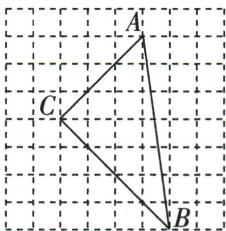

<!-- question-source:start -->
5[2025 安徽合肥期中, 中]如图, 在每个小正方形边长都为 1 的方格纸中, $\triangle ABC$ 的顶点都在方格纸的格点 (小正方形的顶点) 上.

(1)通过观察,可以发现 $\triangle ABC$ 是 ( )
A. 锐角三角形
B. 钝角三角形
C. 直角三角形
D. 直角三角形或锐角三角形

(2)仅利用无刻度的直尺画出 $\triangle ABC$ 的中线AD与角平分线CE.

(3) $\triangle ABC$ 的面积为 $\_\_\_\_,\triangle ABD$ 的面积为 $\_\_\_\_.$

2刷素养▶ 走向重高
<!-- question-source:end -->

![[Q00103286A1]]
