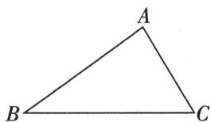
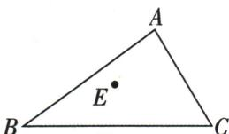

<!-- question-source:start -->
6 核心素养 模型观念 [较难] 如图(1), 有一块三角形菜地, 若从顶点 A 修一条笔直的小路交 BC 于点 D, 小路正好将菜地分成面积相等的两部分.

(1) 找出 D 点的位置并说明理由.

(2) 假设在菜地中有一点 E, 如图(2)所示, BC 上是否存在点 F, 使折线 A-E-F 将 $\triangle ABC$ 分为面积相等的两部分? 若存在, 请找出 F 点的位置, 并说明理由.

图(1)

图(2)
<!-- question-source:end -->

![[Q00103287A1]]
