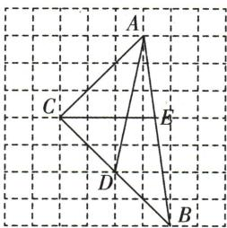

> [!success]- 必刷题
>
> > [!success] **【答案】** C
>
> > [!note]- **【解析】**
> > 【解】(1)由格点可知, $\angle ACB=45^{\circ}+45^{\circ}=90^{\circ}$ ,
> > ∴ $\triangle ABC$ 是直角三角形, 故选 C.
> >
> > (2)如图,线段AD即为所求作的 $\triangle ABC$ 的中线,线段CE即为所求作的 $\triangle ABC$ 的角平分线.
> > (3)由题意知 $S_{\triangle ABC} = \frac{(3+4)\times7}{2}-\frac{3\times3}{2}-\frac{4\times4}{2}=$
> >
> > 关键点按
> > 掌握三角形的
> > 中线将三角形
> > 分成面积相等
> > 的两部分是解
> > 题的关键.
> >
> > 
> >
> > 12, $\therefore S_{\triangle ABD} = \frac{1}{2} S_{\triangle ABC} = 6$ ，故答案为12,6.
> >
> > 易错警示
> > 题干中“中线BD将该三角形的周长分为5和3两个部分”没有明确哪个部分是5,哪个部分是3,因此需要分类讨论,并且这两个部分指的是AB+AD与BC+CD,并不是指AB+AD+BD与BC+CD+BD,需理解题意.
> >
> > ## 刷素养·
