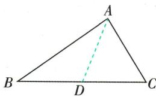
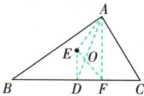

> [!success]- 必刷题
>
> > [!success] **【答案】** 详见解析
>
> > [!note]- **【解析】**
> > 【解】(1)如图(1),取BC的中点D,点D即为所求.理由:连接AD.∵D为BC中点,∴BD=CD,∴△ABD与△ACD等底同高,∴ $S_{\triangle ABD}=S_{\triangle ACD}$ .
> >
> > 
> > 图(1)
> >
> > 
> > 图(2)
> >
> > (2) 存在. 如图(2), 取 $BC$ 的中点 $D$ , 连接 $AD$ , $AE, DE$ , 过点 $A$ 作 $AF \parallel DE$ , 交 $BC$ 于点 $F$ , 点 $F$ 即为所求. 理由如下: 连接 $EF$ 交 $AD$ 于 $O$ . $\because BD = CD$ , $\therefore S_{\triangle ADB} = S_{\triangle ADC}$ . $\because DE \parallel AF$ , $\therefore$ 点 $D$ 到 $AF$ 的距离与点 $E$ 到 $AF$ 的距离相等, $\therefore S_{\triangle AEF} = S_{\triangle ADF}$ , $\therefore S_{\triangle AEO} = S_{\triangle DFO}$ , $\therefore S_{四边形ABFE} = S_{四边形AEFC}$ .
