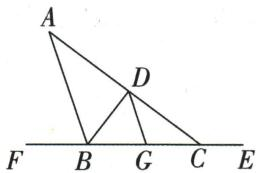

<!-- question-source:start -->
1 如图, 点 B, G, C 在直线 FE 上, 点 D 在线段 AC 上, 则下列是 $\triangle ADB$ 的外角的是 ( )

A. $\angle FBA$ B. $\angle DBC$ C. $\angle CDB$ D. $\angle BDG$
<!-- question-source:end -->

![[Q00103320A1]]
