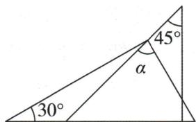

<!-- question-source:start -->
2[2025 浙江杭州期末]一副直角三角板按如图所示方式叠放在一起,则图中 $\angle\alpha$ 的度数是
()

A. $55^{\circ}$ B. $60^{\circ}$ C. $65^{\circ}$ D. $75^{\circ}$
<!-- question-source:end -->

![[Q00103321A1]]
