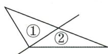
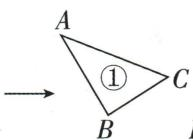
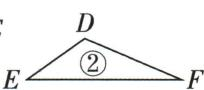

<!-- question-source:start -->
3[2025 河北石家庄期中]如图,三角形纸片沿过一个顶点的直线剪开后得到①②两个三角形纸片,则下列结论一定正确的是()

A. $\angle A = \angle E$ B. $\angle C = \angle E$ C. $\angle B = \angle E + \angle F$ D. $\angle D = \angle A + \angle B$
<!-- question-source:end -->

![[Q00103322A1]]
