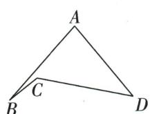
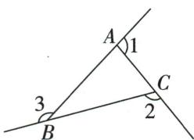

<!-- question-source:start -->
4[2024天津西青区期中]如图,点C是∠BAD内一点,连接CB,CD, $\angle A=80^{\circ},\angle B=10^{\circ},\angle D=40^{\circ}$ ,则 $\angle BCD$ 的度数是()A. $110^{\circ}$ B. $120^{\circ}$ C. $130^{\circ}$ D. $150^{\circ}$

(第4题图)

(第 5 题图)
<!-- question-source:end -->

![[Q00103323A1]]
