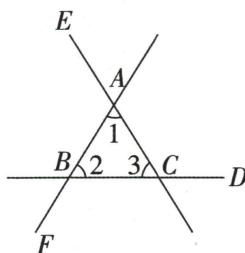

<!-- question-source:start -->
7 用两种方法证明“三角形的外角和等于 $360^{\circ}$ ”. 如图, $\angle BAE, \angle CBF, \angle ACD$ 是 $\triangle ABC$ 的三个外角.

$$
\angle B A E + \angle C B F + \angle A C D = 3 6 0 ^ {\circ}
$$

证法 1: ∵ ∠BAE, ∠CBF, ∠ACD 是△ABC 的三个外角，

$\therefore \angle BAE + \angle CBF + \angle ACD = 2 (\angle 1 + \angle 2 + \angle 3). \quad \therefore$

$$
\therefore \angle B A E + \angle C B F + \angle A C D = 3 6 0 ^ {\circ}.
$$

请把证法 1 补充完整, 并用不同的方法完成证法 2.

2 刷易错 小心有坑\~
<!-- question-source:end -->

![[Q00103326A1]]
