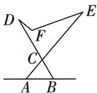
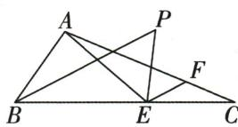

<!-- question-source:start -->
1[2024 山东烟台期中, 中]如图是可调躺椅示意图, AE 与 BD 的交点为 C, $\angle CAB = 50^{\circ}$ , $\angle CBA = 60^{\circ}$ , $\angle CEF = 30^{\circ}$ , $\angle D$ 的大小可以调整. 为了舒适, 需使 $\angle EFD = 130^{\circ}$ , 且 $\angle CAB$ , $\angle CBA$ , $\angle E$ 的度数保持不变, 则 $\angle D$ 应调整为 ( )
A. $10^{\circ}$ B. $20^{\circ}$ C. $25^{\circ}$ D. $30^{\circ}$

(第1题图)
(第2题图)

<!-- question-source:end -->

![[Q00103328A1]]
