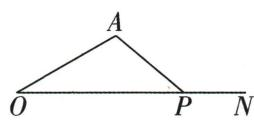

<!-- question-source:start -->
3[2024 河北承德期末, 中]如图, 已知点 P 是射线 ON 上一动点 (不与点 O 重合), $\angle O = 30^{\circ}$ , 若 $\triangle AOP$ 为钝角三角形, 则 $\angle A$ 的取值范围是 \_\_\_\_.

<!-- question-source:end -->

![[Q00103330A1]]
