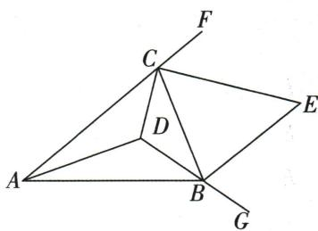

<!-- question-source:start -->
4[2025 浙江宁波期中, 中]如图, 在 $\triangle ABC$ 中, 三个内角的平分线交于点 $D$ , 其中 $\angle CAB = n^{\circ}$ , $\angle CBA = m^{\circ}$ , 延长 $AC$ 至点 $F$ , 延长 $DB$ 至点 $G$ , $\angle FCB$ 与 $\angle CBG$ 的平分线交于点 $E$ , 若 $BE \parallel AC$ , 则 $\frac{4}{7} n + \frac{3}{7} m =$ \_\_\_\_.

<!-- question-source:end -->

![[Q00103331A1]]
